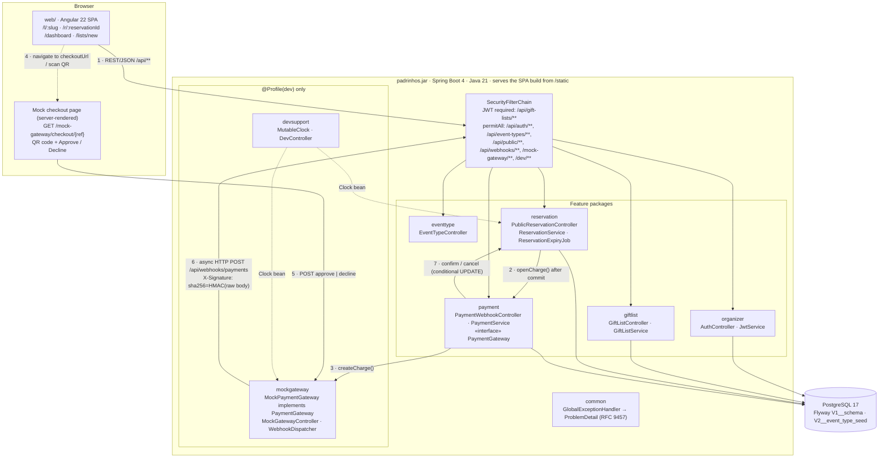
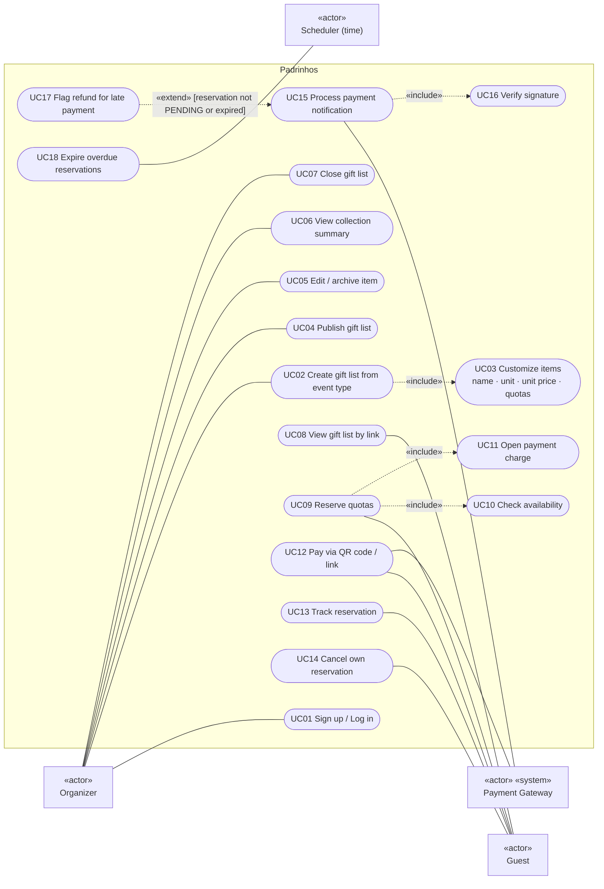
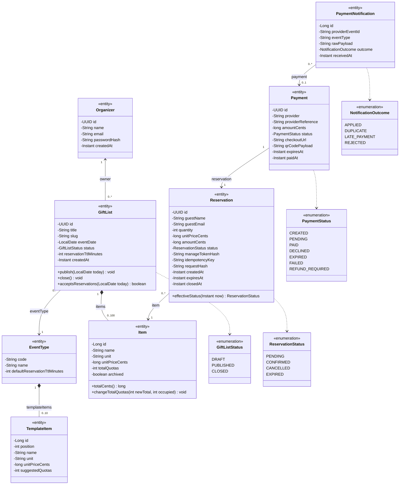
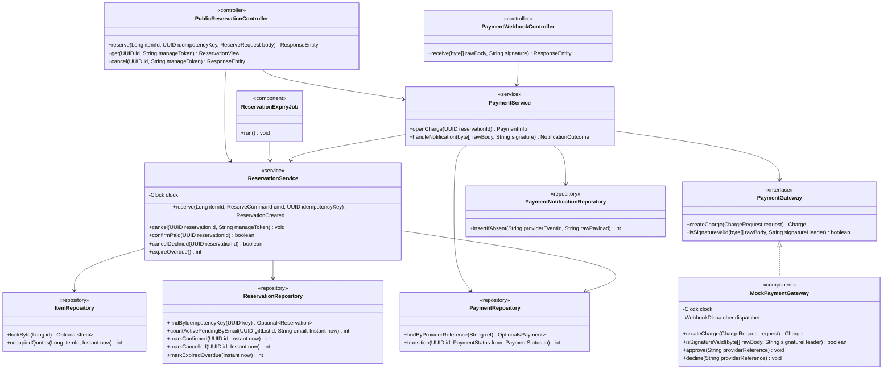
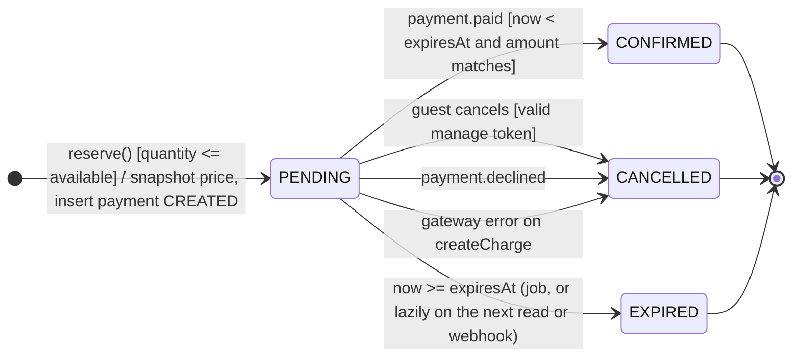
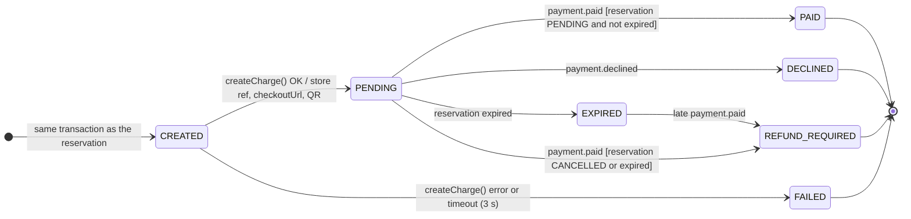
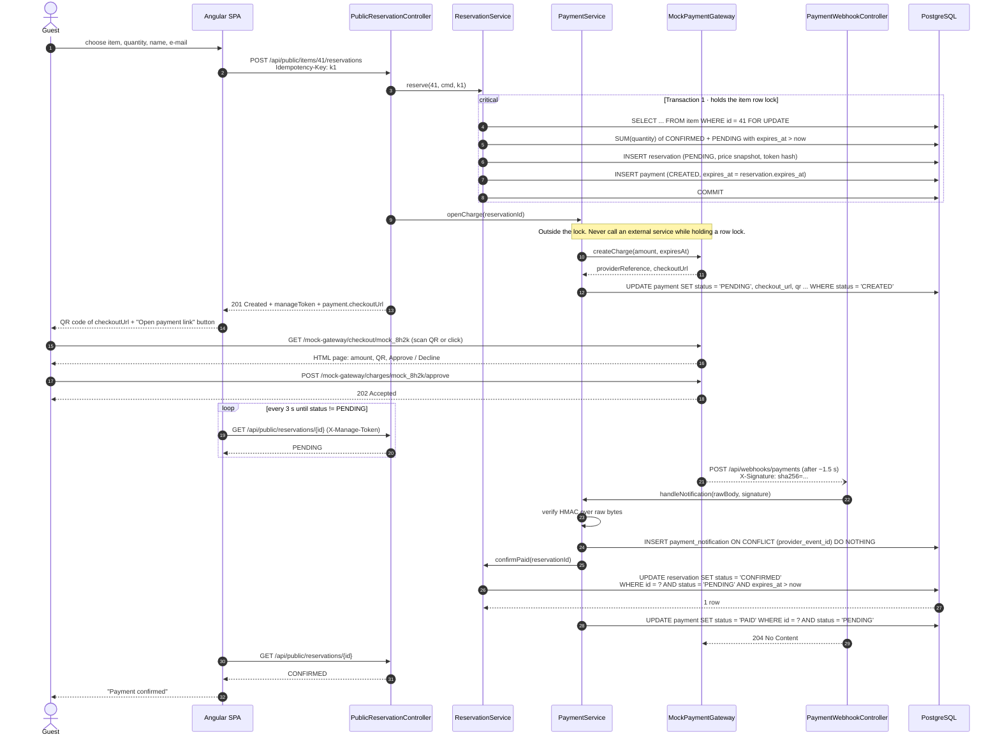
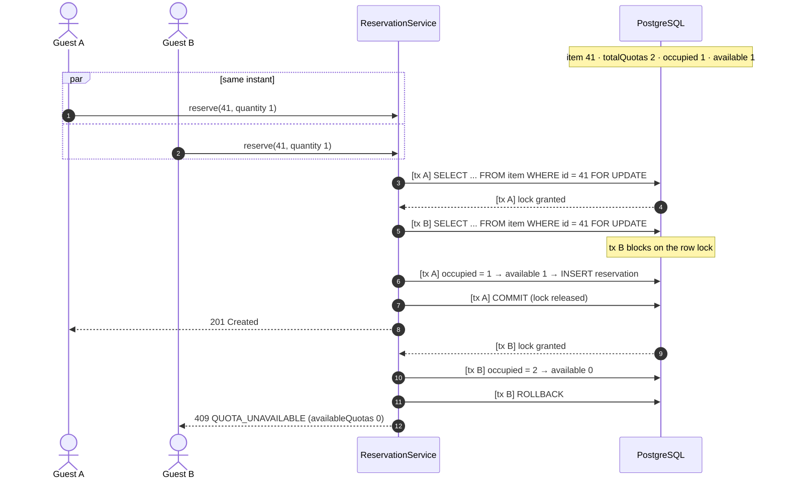
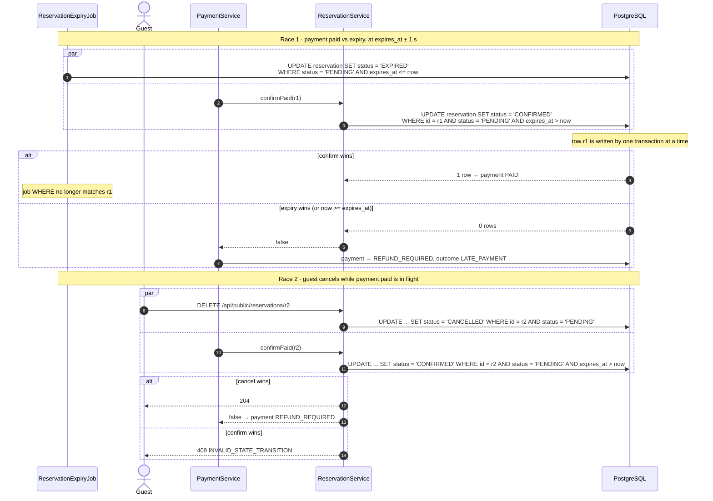

Monorepo · Spring Boot + Angular + REST · v0.2

# Padrinhos

Lista de presentes com cotas para qualquer evento. O organizador parte de 10 itens sugeridos por tipo de evento, ajusta nome, unidade, preço e cotas, e publica um link. O convidado reserva cotas e paga por QR code ou link num gateway simulado; um webhook assinado confirma a reserva. Todo o código, os diagramas, o OpenAPI e as collections estão em inglês; o texto explicativo está em português.

Java 21 Spring Boot 4 Spring Data JPA PostgreSQL 17 Flyway Testcontainers Angular 22 (a confirmar) OpenAPI 3.1

[00Decisões](#decisoes) [AMonorepo](#monorepo) [BArquitetura](#arquitetura) [CCasos de uso](#casos-de-uso) [DClasses](#classes) [EEstados](#estados) [FPagamento (QR)](#pagamento) [GConcorrência](#concorrencia) [HEdge cases](#edge-cases) [IItens padrão](#modelos) [JEndpoints](#endpoints) [KOpenAPI](#openapi) [LCollections](#collections)

## O que mudou nesta versão decisões

- **Confirmação automática.** O pagamento entra por um webhook assinado. A confirmação manual pelo organizador saiu, porque não existe mais Pix fora do sistema.
- **Prazo de 30 min por padrão.** Agora o pagamento é imediato. A cobrança expira no mesmo instante que a reserva; se expirasse depois, pagamentos atrasados seriam garantidos.
- **Pagamento recusado cancela a reserva** e libera as cotas na hora. Para tentar de novo, o convidado faz uma nova reserva. Isso dá uma cobrança por reserva (1:1).
- **Pagamento atrasado não ressuscita a reserva.** O pagamento vira `REFUND_REQUIRED` e aparece no resumo do organizador.
- **Token de gerenciamento no header** (`X-Manage-Token`), não na query string, que vai parar em logs. É guardado como hash SHA-256.
- **`Idempotency-Key` obrigatório** na reserva. Um clique duplo ou um retry de rede não cria duas reservas.
- **`Clock` injetado.** As queries recebem `now` da aplicação, nunca `CURRENT_TIMESTAMP`. No perfil dev, um `MutableClock` permite reproduzir expirações pela collection.
- **`GiftList`, não `List`**, para não colidir com `java.util.List`. Códigos de evento: `WEDDING`, `BABY_SHOWER`, `BARBECUE`, `OTHER`.
- **Testes de integração com Testcontainers (PostgreSQL),** não H2. O H2 não reproduz fielmente o `FOR UPDATE` nem os locks de linha do Postgres, então um teste de concorrência em H2 não prova nada.

## Monorepo estrutura

Um repositório, um JAR. O POM pai builda `api/` e `web/`; em produção o build do Angular vai para `static/` dentro do JAR, então não existe CORS em produção.

```
padrinhos/
├── pom.xml                              # parent: modules api, web
├── docker-compose.yml                   # postgres:17
├── README.md
├── docs/api/
│   ├── openapi.yaml                     # section K
│   ├── collections/
│   │   ├── padrinhos.postman_collection.json
│   │   ├── padrinhos-local.postman_environment.json
│   │   └── padrinhos.insomnia.json
│   └── scripts/race-last-quota.sh       # real concurrency, parallel curl
├── api/
│   ├── pom.xml
│   └── src/
│       ├── main/java/dev/padrinhos/
│       │   ├── organizer/               # Organizer, AuthController, JwtService
│       │   ├── eventtype/               # EventType, TemplateItem, EventTypeController
│       │   ├── giftlist/                # GiftList, Item, GiftListService, GiftListController
│       │   ├── reservation/             # Reservation, ReservationService, ReservationExpiryJob
│       │   ├── payment/                 # Payment, PaymentGateway, PaymentService, PaymentWebhookController
│       │   ├── mockgateway/             # @Profile("dev"): MockPaymentGateway, MockGatewayController
│       │   ├── devsupport/              # @Profile("dev"): MutableClock, DevController
│       │   └── common/                  # GlobalExceptionHandler, ErrorCode, Money
│       ├── main/resources/
│       │   ├── application.yml
│       │   ├── application-dev.yml      # payment.webhook-secret, mock-gateway.*
│       │   ├── templates/mock-checkout.html
│       │   └── db/migration/
│       │       ├── V1__schema.sql
│       │       └── V2__event_type_seed.sql
│       └── test/java/dev/padrinhos/
│           ├── ReservationConcurrencyIT.java     # 50 threads, 10 quotas
│           ├── IdempotencyRaceIT.java
│           ├── ConfirmVsExpireRaceIT.java
│           ├── CancelVsPaidRaceIT.java
│           ├── PaymentWebhookIT.java             # signature, duplicate, late, mismatch
│           └── GatewayFailureIT.java
└── web/
    ├── pom.xml                          # frontend-maven-plugin: npm ci + ng build
    ├── package.json
    ├── proxy.conf.json                  # /api, /mock-gateway → localhost:8080
    └── src/app/
        ├── guest/                       # /l/:slug, /r/:reservationId
        ├── organizer/                   # /dashboard, /lists/new, /lists/:id
        └── api/                         # generated from docs/api/openapi.yaml
```

## Arquitetura componentes e fluxo

Os números nas setas seguem a ordem do fluxo de pagamento. O gateway simulado roda dentro do mesmo JAR, mas chama o webhook por HTTP, como um provedor real faria. Por isso a chamada passa pelo filtro de segurança e pela verificação de assinatura.



### Para o Astah

1. Um fluxograma não é UML. No Astah, este diagrama vira **dois**: um **diagrama de componentes** e um **diagrama de implantação**.
2. **Componentes:** um componente por pacote (`organizer`, `eventtype`, `giftlist`, `reservation`, `payment`, `mockgateway`, `devsupport`). `PaymentGateway` é uma interface **fornecida** (bola) por `mockgateway` e **requerida** (soquete) por `payment`. O Mermaid não tem notação de bola e soquete.
3. **Implantação:** nó `Browser` «device»; nó `JVM 21` «executionEnvironment» com o artefato `padrinhos.jar`; nó `PostgreSQL 17` «database». Caminhos de comunicação: HTTP(S) entre Browser e JVM, JDBC entre JVM e PostgreSQL.
4. O webhook em dev é um **loopback** (JVM → JVM via HTTP). Desenhe como um caminho de comunicação do nó para ele mesmo e anote "dev only; in production the provider is an external node".
5. Marque `mockgateway` e `devsupport` com o estereótipo «profile dev». Em produção eles não existem, e outro adaptador implementaria `PaymentGateway`.
6. A numeração 1–7 é ordem de mensagens, informação de diagrama de sequência. No Astah, tire a numeração das setas do diagrama de componentes; a ordem já está no diagrama da seção F.

## Casos de uso atores, include, extend

O Mermaid não tem notação de caso de uso. Este diagrama é um fluxograma que reproduz a estrutura, ou seja, atores, fronteira e relações, para servir de referência ao redesenho no Astah. A tabela logo abaixo do diagrama é a fonte da verdade.



| ID | Use case | Actor | Precondition | Exception flows (error code) |
| --- | --- | --- | --- | --- |
| UC01 | Sign up / Log in | Organizer | — | E-mail taken (EMAIL_ALREADY_REGISTERED); wrong credentials (INVALID_CREDENTIALS, same message for unknown e-mail) |
| UC02 | Create gift list from event type | Organizer | Logged in | Event date in the past (EVENT_DATE_IN_PAST); more than 100 items (VALIDATION_FAILED) |
| UC03 | Customize items | — (included) | Inside UC02 | Price ≤ 0 or quotas \< 1 (VALIDATION_FAILED) |
| UC04 | Publish gift list | Organizer | List in DRAFT | No items (LIST_HAS_NO_ITEMS); not DRAFT (INVALID_STATE_TRANSITION) |
| UC05 | Edit / archive item | Organizer | List not CLOSED | Quotas below occupied (QUOTAS_BELOW_OCCUPIED); archive with active reservations (ITEM_HAS_ACTIVE_RESERVATIONS) |
| UC06 | View collection summary | Organizer | Owner of the list | Other organizer's list → 404 |
| UC07 | Close gift list | Organizer | List PUBLISHED | Not PUBLISHED (INVALID_STATE_TRANSITION) |
| UC08 | View gift list by link | Guest | List PUBLISHED or CLOSED | DRAFT or unknown slug → 404 |
| UC09 | Reserve quotas | Guest | List accepts reservations | Not enough quotas (QUOTA_UNAVAILABLE); closed or past date (LIST_NOT_ACCEPTING_RESERVATIONS); > 3 pending per e-mail (TOO_MANY_PENDING_RESERVATIONS); key reused with another body (IDEMPOTENCY_KEY_MISMATCH) |
| UC10 | Check availability | — (included) | Item row locked | — |
| UC11 | Open payment charge | — (included) | Reservation committed | Gateway error or timeout → reservation CANCELLED, payment FAILED (PAYMENT_GATEWAY_UNAVAILABLE) |
| UC12 | Pay via QR code / link | Guest, Payment Gateway | Payment PENDING | Charge expired → 410 on the gateway; declined → reservation CANCELLED |
| UC13 | Track reservation | Guest | Has manage token | Wrong token → 404 |
| UC14 | Cancel own reservation | Guest | Reservation PENDING | Not PENDING (INVALID_STATE_TRANSITION); wrong token → 404 |
| UC15 | Process payment notification | Payment Gateway | — | Duplicate event → no-op; unknown reference or amount mismatch → stored as REJECTED, 204 |
| UC16 | Verify signature | — (included) | Raw body available | Invalid or missing (INVALID_SIGNATURE, 401) |
| UC17 | Flag refund for late payment | — (extends UC15) | Reservation not PENDING or expired | — |
| UC18 | Expire overdue reservations | Scheduler | Every 60 s | Runs on N instances at once → idempotent, no effect twice |

### Para o Astah

1. Atores como bonecos e casos de uso como elipses, dentro de uma fronteira de sistema chamada `Padrinhos`. O Mermaid só consegue desenhar retângulos e pílulas.
2. Atores primários à esquerda (Organizer, Guest) e secundários à direita (Payment Gateway com «system», Scheduler).
3. **Scheduler como ator é discutível.** Se o professor não aceitar o tempo como ator, remova-o e coloque uma nota em UC18: "triggered every 60 s by @Scheduled". Decida isso antes de entregar.
4. **Direção das setas.** «include»: tracejada, saindo do caso base para o incluído (UC09 → UC10, UC09 → UC11, UC02 → UC03, UC15 → UC16). «extend»: tracejada, saindo da extensão para o caso base (UC17 → UC15). O diagrama acima já segue essa direção.
5. **Ponto de extensão.** No UC15, adicione o compartimento "extension points: afterConfirmAttempt" e uma nota de condição na seta «extend»: `{reservation not PENDING or expiresAt <= now}`. O Mermaid não tem compartimento de ponto de extensão.
6. **UC01 é pré-condição, não «include».** Não ligue UC02–UC07 a "Log in" com «include»; é um erro comum e costuma tirar ponto.
7. UC12 tem dois atores: o Guest inicia e o Payment Gateway participa. Associe os dois sem seta de navegação.
8. Não existe generalização entre Guest e Organizer. Um organizador que reserva cotas age como Guest, sem login.

## Classes domínio + aplicação

### Modelo de domínio (entidades JPA)

A direção das setas segue o mapeamento JPA: aponta do lado que guarda a chave estrangeira. O disponível de um item não é atributo persistido; é derivado das reservas.



| Class | Constraint (put as OCL note in Astah) | Enforced by |
| --- | --- | --- |
| Organizer | email {unique}, lower-cased before save | UNIQUE index on lower(email) |
| TemplateItem | (eventType, position) {unique}; position in 1..10 | UNIQUE + CHECK |
| GiftList | slug {unique}; status = PUBLISHED implies items->select(not archived)->notEmpty() | UNIQUE; GiftList.publish() |
| GiftList | reservationTtlMinutes in 10..1440 | CHECK + Bean Validation |
| Item | totalQuotas >= 1; unitPriceCents >= 1 | CHECK |
| Item | /availableQuotas = totalQuotas - reservations->select(status = CONFIRMED or (status = PENDING and expiresAt > now)).quantity->sum() | Derived; computed under row lock |
| Item | inv: /availableQuotas >= 0 | SELECT … FOR UPDATE in reserve() and updateItem() |
| Reservation | quantity >= 1; amountCents = quantity * unitPriceCents | CHECK |
| Reservation | unitPriceCents is a snapshot of item.unitPriceCents at creation {readOnly} | No setter; column updatable = false |
| Reservation | idempotencyKey {unique}; manageTokenHash = sha256(token) | UNIQUE |
| Payment | reservation {unique}; providerReference {unique}; amountCents = reservation.amountCents; expiresAt = reservation.expiresAt | UNIQUE; set in the same transaction |
| PaymentNotification | providerEventId {unique} | INSERT … ON CONFLICT DO NOTHING |

### Camada de aplicação

Controllers, services, repositories e o ponto de troca do gateway. DTOs e comandos ficam fora do diagrama, porque são records sem comportamento.



### Para o Astah

1. **Restrições.** Cole cada linha da tabela acima como nota de restrição (OCL) presa à classe. O Mermaid não desenha `{…}` nem notas ligadas a classes.
2. **Atributo derivado.** Adicione `/availableQuotas : int {derived}` em `Item`. Ele ficou fora do diagrama Mermaid porque lá seria lido como campo persistido.
3. **Nomes de papel nas pontas.** O Mermaid coloca o rótulo no meio da linha. No Astah, os nomes (`items`, `owner`, `eventType`, `item`, `reservation`, `payment`, `templateItems`) vão na ponta oposta à classe dona do atributo.
4. **Linhas tracejadas até os enums.** Elas existem só porque o Mermaid não liga um atributo ao seu tipo. No Astah, apague essas linhas: o atributo tipado (`status : ReservationStatus`) já expressa a relação.
5. **Composições** (losango cheio): `GiftList ◆— Item` e `EventType ◆— TemplateItem`. `Organizer — GiftList` é associação simples, não agregação: apagar um organizador não é um caso de uso.
6. `PaymentNotification → Payment` é **0..1**, porque notificações com referência desconhecida também são gravadas. Não "corrija" para 1.
7. Na camada de aplicação, as setas cheias representam campos `private final` injetados pelo construtor. Por isso são associações e não dependências «use». Se o professor preferir dependência, troque todas, sem misturar.
8. Estereótipos «entity», «enumeration», «interface», «service», «repository», «controller» e «component» precisam ser criados como estereótipos personalizados no Astah. A realização de `PaymentGateway` é tracejada com triângulo vazado.
9. `MutableClock`, `WebhookDispatcher` e os DTOs foram omitidos de propósito. Se o professor pedir completude, coloque-os num diagrama de pacotes separado.

## Estados reservation + payment

### Reservation



### Payment



- **Toda transição é um UPDATE condicional** com `WHERE status = <origem>`. Se afetar 0 linhas, outra transação já mudou o estado.
- **EXPIRED tem duas origens**: o job, ou a leitura ou o webhook que encontra uma reserva vencida ainda marcada como PENDING. O GET já devolve o *effective status*.
- **Nenhum estado final tem saída.** Não existe reabrir reserva. Um pagamento atrasado vira REFUND_REQUIRED no *pagamento*, não altera a reserva.

### Para o Astah

1. Escreva as transições no formato UML `event [guard] / action`. O Mermaid trata o rótulo como texto livre, então a sintaxe acima é só aproximada.
2. No pagamento, a decisão entre PAID e REFUND_REQUIRED após `payment.paid` é um **pseudoestado de escolha** (losango) com as duas guardas. No Mermaid ela virou duas setas paralelas.
3. Desenhe as duas máquinas no mesmo diagrama, como regiões ortogonais de "ReservationLifecycle", ou separadas. Não junte os estados numa máquina só: são ciclos de vida de objetos diferentes.

## Pagamento por QR code / link gateway simulado

A resposta da reserva traz o `checkoutUrl`. A SPA mostra o QR code dessa URL e um botão "Abrir link de pagamento". A página de checkout é do gateway simulado, renderizada pelo Spring, e não da SPA, para imitar um provedor externo de verdade.



Mock Gateway · checkoutPENDING

R$ 90,00

Picanha · 1 kg · Churrasco do Erick

Expira em 30 min (mesmo instante da reserva)

http://192.168.0.10:8080/mock-gateway/checkout/mock_8h2k1x9q0w3e5r7t6y4u

### O que acontece no back-end

Prévia ilustrativa. Clique em Approve ou Decline para ver a sequência de eventos.

- **O QR code aponta para `app.public-base-url`.** Com `localhost`, o celular que escanear não abre a página. Na demo, use o IP da rede local.
- **Polling a cada 3 s** em vez de SSE/WebSocket. É mais simples e suficiente, e o mesmo GET serve para a tela "minha reserva".
- **O webhook lê o corpo cru** (`byte[]`). Se o Spring desserializar para DTO antes de validar o HMAC, a assinatura deixa de bater.
- **Atraso e duplicação configuráveis** no gateway simulado: `mock-gateway.webhook-delay-ms` e `mock-gateway.duplicate-deliveries`. Servem para demonstrar a idempotência ao vivo.

## Concorrência lock + corridas de transição

### Última cota, dois convidados



### Corridas de transição de estado



### Para o Astah

1. Os fragmentos `par`, `alt`, `loop` e `critical` existem em UML. Recrie-os com os mesmos operandos e guardas.
2. Os prefixos `[tx A]` e `[tx B]` substituem duas linhas de vida de transação. No Astah, prefira duas linhas de vida `:Transaction A` e `:Transaction B` entre o Service e o PostgreSQL.
3. O bloqueio da tx B deve aparecer como uma **barra de ativação suspensa** (ou uma restrição de duração `{blocked until A commits}`). O Mermaid só consegue mostrar isso como nota.
4. A mensagem do webhook é **assíncrona** (seta aberta). Confira que o Astah não a converta em síncrona ao redesenhar.

## Edge cases onde cada um é provado

A última coluna diz onde cada caso é reproduzido. collection roda no Postman ou no Insomnia. JUnit é teste de integração com Testcontainers. script é o `race-last-quota.sh`. manual precisa de uma pessoa, e são esses que não dá para automatizar nem desenhar no Mermaid.

| ID | Cenário | Comportamento esperado | Onde |
| --- | --- | --- | --- |
| EC01 | Dois convidados disputam a última cota no mesmo instante | Exatamente 1 × 201 e o resto 409 QUOTA_UNAVAILABLE | JUnit script A collection é sequencial e não reproduz isso |
| EC02 | Quantidade maior que o disponível | 409 com `availableQuotas` | collection 05 |
| EC03 | Quantidade 0 ou negativa | 400 VALIDATION_FAILED com o campo | collection 05 |
| EC04 | Clique duplo / retry com a mesma Idempotency-Key | 200 com a mesma reserva | collection 03 |
| EC05 | Mesma key, corpo diferente | 422 IDEMPOTENCY_KEY_MISMATCH (checado antes da disponibilidade) | collection 05 |
| EC06 | Duas requisições simultâneas com a mesma key | Uma insere; a outra bate no UNIQUE, relê e devolve replay 200 | JUnit IdempotencyRaceIT |
| EC07 | Gateway fora do ar ou timeout no createCharge | Reserva CANCELLED, pagamento FAILED, 502. As cotas voltam na hora | JUnit GatewayFailureIT |
| EC08 | Webhook duplicado (mesmo eventId) | 204, nenhuma mudança de estado | collection 06 |
| EC09 | Assinatura inválida ou ausente | 401 INVALID_SIGNATURE | collection 06 |
| EC10 | Webhook com referência desconhecida | 204 e outcome REJECTED, para o provedor parar de reenviar | collection 06 |
| EC11 | Webhook com valor diferente do cobrado | 204, REJECTED; a reserva continua PENDING | collection 07 |
| EC12 | Pagamento chega depois do prazo | Reserva EXPIRED, pagamento REFUND_REQUIRED, valor em `refundRequiredCents` | collection 07 (dev clock) |
| EC13 | payment.paid e expiração no mesmo segundo | Exatamente uma transição vence | JUnit ConfirmVsExpireRaceIT |
| EC14 | Convidado cancela enquanto o pagamento é confirmado | Uma vence; se o cancelamento vencer, o pagamento vira REFUND_REQUIRED | JUnit CancelVsPaidRaceIT |
| EC15 | Job de expiração parado | O disponível continua correto, porque é calculado por `expiresAt` | collection 07 |
| EC16 | Job rodando em duas instâncias ao mesmo tempo | Idempotente; nenhuma reserva é expirada duas vezes. Não precisa de ShedLock | JUnit |
| EC17 | Organizador reduz cotas abaixo do ocupado | 409 QUOTAS_BELOW_OCCUPIED | collection 05 |
| EC18 | Organizador muda o preço com reservas pendentes | As pendentes mantêm o preço antigo (snapshot); o valor da cobrança não muda | JUnit |
| EC19 | Arquivar item com reservas ativas | 409 ITEM_HAS_ACTIVE_RESERVATIONS | collection 05 |
| EC20 | Lista em DRAFT acessada pelo link | 404 | collection 02 |
| EC21 | Token de gerenciamento errado | 404 (sem revelar se a reserva existe) | collection 04 |
| EC22 | Cancelar reserva que não está PENDING | 409 INVALID_STATE_TRANSITION | collection 04 |
| EC23 | Lista fechada | 409 LIST_NOT_ACCEPTING_RESERVATIONS; pendentes ainda podem ser pagas até expirar | collection 07 |
| EC24 | Data do evento: 22:30 em São Paulo já é amanhã em UTC | "Hoje" é calculado em `app.zone`, não em UTC | JUnit com Clock fixo em `2026-12-01T01:30Z` |
| EC25 | Alguém reserva todas as cotas e não paga | No máximo 3 PENDING por e-mail por lista (429), e o prazo de 30 min limita o estrago. **Limitação conhecida:** o e-mail não é verificado, então dá para burlar trocando de e-mail. Rate limit por IP fica fora do escopo | JUnit |
| EC26 | Organizador acessa a lista de outro organizador | 404, não 403 | JUnit (precisa de dois usuários) |
| EC27 | Celular escaneia um QR que aponta para localhost | A página não abre; configure `app.public-base-url` com o IP da rede local | manual |
| EC28 | Disponível desatualizado na tela do convidado | A SPA mostra "Essa cota acabou de ser reservada" no 409 e recarrega a lista | manual (duas abas) |
| EC29 | Convidado fecha a aba durante o pagamento | O webhook confirma mesmo assim; ao reabrir `/r/:id`, a tela mostra CONFIRMED | manual |

## Itens padrão por tipo de evento prévia editável

São 10 sugestões por tipo, gravadas na migration `V2__event_type_seed.sql`. O organizador edita tudo antes de criar a lista. Os códigos são em inglês, e os nomes dos itens ficam em português porque são dados exibidos ao usuário. Os preços são exemplos.

| name | unit | unitPrice (R$) | quotas | total | Remover |
| --- | --- | --- | --- | --- | --- |
|  |  |  |  |  |  |

Edite qualquer célula.

## Endpoints REST

| Route | Auth | Responses |
| --- | --- | --- |
| POST/api/auth/register | public | 201 · 400 · 409 |
| POST/api/auth/login | public | 200 · 400 · 401 |
| GET/api/event-types | public | 200 |
| GET/api/event-types/{eventTypeCode}/template-items | public | 200 · 404 |
| GET/api/gift-lists | bearer | 200 · 401 |
| POST/api/gift-lists | bearer | 201 · 400 · 401 · 404 · 422 |
| GET/api/gift-lists/{giftListId} | bearer | 200 · 401 · 404 |
| PATCH/api/gift-lists/{giftListId} | bearer | 200 · 400 · 401 · 404 · 409 |
| POST/api/gift-lists/{giftListId}/publish | bearer | 200 · 401 · 404 · 409 · 422 |
| POST/api/gift-lists/{giftListId}/close | bearer | 200 · 401 · 404 · 409 |
| POST/api/gift-lists/{giftListId}/items | bearer | 201 · 400 · 401 · 404 · 409 |
| PUT/api/gift-lists/{giftListId}/items/{itemId} | bearer | 200 · 400 · 401 · 404 · 409 |
| DELETE/api/gift-lists/{giftListId}/items/{itemId} | bearer | 204 · 401 · 404 · 409 |
| GET/api/gift-lists/{giftListId}/summary | bearer | 200 · 401 · 404 |
| GET/api/public/gift-lists/{slug} | public | 200 · 404 |
| POST/api/public/items/{itemId}/reservations | public | 201 · 200 · 400 · 404 · 409 · 422 · 429 · 502 |
| GET/api/public/reservations/{reservationId} | public | 200 · 404 |
| DELETE/api/public/reservations/{reservationId} | public | 204 · 404 · 409 |
| POST/api/webhooks/payments | public | 204 · 400 · 401 |
| GET/mock-gateway/checkout/{providerReference} | dev only | 200 · 404 |
| GET/mock-gateway/charges/{providerReference} | dev only | 200 · 404 |
| POST/mock-gateway/charges/{providerReference}/approve | dev only | 202 · 404 · 409 · 410 |
| POST/mock-gateway/charges/{providerReference}/decline | dev only | 202 · 404 · 409 · 410 |
| GET/dev/clock | dev only | 200 |
| POST/dev/clock/advance | dev only | 200 |
| POST/dev/clock/reset | dev only | 200 |
| POST/dev/jobs/expire-reservations | dev only | 200 |

## OpenAPI esboço 3.1

Arquivo em `docs/api/openapi.yaml`. Passa no `redocly lint` sem erros. Os tipos do Angular em `web/src/app/api/` são gerados a partir dele.

Ver openapi.yaml (1000 linhas)

```
openapi: 3.1.0
info:
  title: Padrinhos API
  version: 0.1.0-draft
  summary: Gift registry with quotas for weddings, baby showers, barbecues and other events.
  description: |
    DRAFT. Contract sketch for the Padrinhos monorepo (api/ Spring Boot, web/ Angular).

    Conventions
    - Money is always an integer amount of cents (BRL). Never floating point.
    - Errors use RFC 9457 Problem Details (`application/problem+json`) with an extra `code` field.
    - 400 = malformed or invalid input (Bean Validation). 409 = state conflict. 422 = well-formed
      request that breaks a business rule. 404 is also returned when a resource exists but the caller
      is not allowed to see it (no existence oracle).
    - Timestamps are ISO-8601 UTC (`Instant`). `eventDate` is a local date in the zone configured by
      `app.zone` (default America/Sao_Paulo).
    - `/mock-gateway/**` and `/dev/**` exist only with the `dev` Spring profile.
servers:
  - url: http://localhost:8080
    description: Local (dev profile)
tags:
  - name: Auth
    description: Organizer registration and login (JWT).
  - name: Event types
    description: Event types and their 10 suggested items.
  - name: Gift lists
    description: Organizer area. Requires a bearer token.
  - name: Public
    description: Guest area. No login; reservations are managed with a one-time manage token.
  - name: Webhooks
    description: Called by the payment provider.
  - name: Mock gateway
    description: Fake payment provider (dev profile only). Renders the checkout page with a QR code.
  - name: Dev support
    description: Controllable clock and job triggers to reproduce time-based edge cases (dev profile only).

security:
  - bearerAuth: []

paths:
  /api/auth/register:
    post:
      tags: [Auth]
      operationId: register
      summary: Register
      security: []
      requestBody:
        required: true
        content:
          application/json:
            schema: { $ref: '#/components/schemas/RegisterRequest' }
      responses:
        '201':
          description: Organizer created.
          content:
            application/json:
              schema: { $ref: '#/components/schemas/OrganizerResponse' }
        '400': { $ref: '#/components/responses/ValidationFailed' }
        '409':
          description: EMAIL_ALREADY_REGISTERED
          content:
            application/problem+json:
              schema: { $ref: '#/components/schemas/Problem' }

  /api/auth/login:
    post:
      tags: [Auth]
      operationId: login
      summary: Login
      security: []
      requestBody:
        required: true
        content:
          application/json:
            schema: { $ref: '#/components/schemas/LoginRequest' }
      responses:
        '200':
          description: JWT issued.
          content:
            application/json:
              schema: { $ref: '#/components/schemas/TokenResponse' }
        '400': { $ref: '#/components/responses/ValidationFailed' }
        '401':
          description: INVALID_CREDENTIALS (same response for unknown email and wrong password).
          content:
            application/problem+json:
              schema: { $ref: '#/components/schemas/Problem' }

  /api/event-types:
    get:
      tags: [Event types]
      operationId: listEventTypes
      summary: List event types
      security: []
      responses:
        '200':
          description: All event types, ordered by name.
          content:
            application/json:
              schema:
                type: array
                items: { $ref: '#/components/schemas/EventType' }

  /api/event-types/{eventTypeCode}/template-items:
    get:
      tags: [Event types]
      operationId: listTemplateItems
      summary: List template items
      security: []
      parameters:
        - $ref: '#/components/parameters/EventTypeCode'
      responses:
        '200':
          description: Suggested items, ordered by position. Empty for OTHER.
          content:
            application/json:
              schema:
                type: array
                items: { $ref: '#/components/schemas/TemplateItem' }
        '404': { $ref: '#/components/responses/NotFound' }

  /api/gift-lists:
    post:
      tags: [Gift lists]
      operationId: createGiftList
      summary: Create gift list
      description: |
        Creates a DRAFT list. The client sends the full item list (usually the template items after
        the organizer edited them). Templates are copied, never referenced.
      requestBody:
        required: true
        content:
          application/json:
            schema: { $ref: '#/components/schemas/CreateGiftListRequest' }
      responses:
        '201':
          description: Created.
          headers:
            Location:
              schema: { type: string, example: /api/gift-lists/0f8b2c9e-6c1d-4a51-9a39-2d7f7e3b1c11 }
          content:
            application/json:
              schema: { $ref: '#/components/schemas/GiftList' }
        '400': { $ref: '#/components/responses/ValidationFailed' }
        '401': { $ref: '#/components/responses/Unauthorized' }
        '404': { $ref: '#/components/responses/NotFound' }
        '422':
          description: EVENT_DATE_IN_PAST
          content:
            application/problem+json:
              schema: { $ref: '#/components/schemas/Problem' }
    get:
      tags: [Gift lists]
      operationId: listMyGiftLists
      summary: List my gift lists
      responses:
        '200':
          description: Lists owned by the caller.
          content:
            application/json:
              schema:
                type: array
                items: { $ref: '#/components/schemas/GiftListSummary' }
        '401': { $ref: '#/components/responses/Unauthorized' }

  /api/gift-lists/{giftListId}:
    parameters:
      - $ref: '#/components/parameters/GiftListId'
    get:
      tags: [Gift lists]
      operationId: getGiftList
      summary: Get gift list
      responses:
        '200':
          description: Full list with items (including archived ones, flagged).
          content:
            application/json:
              schema: { $ref: '#/components/schemas/GiftList' }
        '401': { $ref: '#/components/responses/Unauthorized' }
        '404': { $ref: '#/components/responses/NotFound' }
    patch:
      tags: [Gift lists]
      operationId: updateGiftList
      summary: Update gift list
      requestBody:
        required: true
        content:
          application/json:
            schema: { $ref: '#/components/schemas/UpdateGiftListRequest' }
      responses:
        '200':
          description: Updated.
          content:
            application/json:
              schema: { $ref: '#/components/schemas/GiftList' }
        '400': { $ref: '#/components/responses/ValidationFailed' }
        '401': { $ref: '#/components/responses/Unauthorized' }
        '404': { $ref: '#/components/responses/NotFound' }
        '409':
          description: INVALID_STATE_TRANSITION (list is CLOSED)
          content:
            application/problem+json:
              schema: { $ref: '#/components/schemas/Problem' }

  /api/gift-lists/{giftListId}/publish:
    parameters:
      - $ref: '#/components/parameters/GiftListId'
    post:
      tags: [Gift lists]
      operationId: publishGiftList
      summary: Publish gift list
      responses:
        '200':
          description: Status is now PUBLISHED and the slug is reachable publicly.
          content:
            application/json:
              schema: { $ref: '#/components/schemas/GiftList' }
        '401': { $ref: '#/components/responses/Unauthorized' }
        '404': { $ref: '#/components/responses/NotFound' }
        '409':
          description: INVALID_STATE_TRANSITION (not DRAFT)
          content:
            application/problem+json:
              schema: { $ref: '#/components/schemas/Problem' }
        '422':
          description: LIST_HAS_NO_ITEMS or EVENT_DATE_IN_PAST
          content:
            application/problem+json:
              schema: { $ref: '#/components/schemas/Problem' }

  /api/gift-lists/{giftListId}/close:
    parameters:
      - $ref: '#/components/parameters/GiftListId'
    post:
      tags: [Gift lists]
      operationId: closeGiftList
      summary: Close gift list
      description: Stops new reservations. PENDING reservations can still be paid until they expire.
      responses:
        '200':
          description: Status is now CLOSED.
          content:
            application/json:
              schema: { $ref: '#/components/schemas/GiftList' }
        '401': { $ref: '#/components/responses/Unauthorized' }
        '404': { $ref: '#/components/responses/NotFound' }
        '409':
          description: INVALID_STATE_TRANSITION (not PUBLISHED)
          content:
            application/problem+json:
              schema: { $ref: '#/components/schemas/Problem' }

  /api/gift-lists/{giftListId}/items:
    parameters:
      - $ref: '#/components/parameters/GiftListId'
    post:
      tags: [Gift lists]
      operationId: addItem
      summary: Add item
      requestBody:
        required: true
        content:
          application/json:
            schema: { $ref: '#/components/schemas/ItemInput' }
      responses:
        '201':
          description: Created.
          content:
            application/json:
              schema: { $ref: '#/components/schemas/Item' }
        '400': { $ref: '#/components/responses/ValidationFailed' }
        '401': { $ref: '#/components/responses/Unauthorized' }
        '404': { $ref: '#/components/responses/NotFound' }
        '409':
          description: INVALID_STATE_TRANSITION (list is CLOSED)
          content:
            application/problem+json:
              schema: { $ref: '#/components/schemas/Problem' }

  /api/gift-lists/{giftListId}/items/{itemId}:
    parameters:
      - $ref: '#/components/parameters/GiftListId'
      - $ref: '#/components/parameters/ItemId'
    put:
      tags: [Gift lists]
      operationId: updateItem
      summary: Update item
      description: |
        Takes the same row lock used by reservations. A price change does not affect existing
        reservations (they keep a price snapshot).
      requestBody:
        required: true
        content:
          application/json:
            schema: { $ref: '#/components/schemas/ItemInput' }
      responses:
        '200':
          description: Updated.
          content:
            application/json:
              schema: { $ref: '#/components/schemas/Item' }
        '400': { $ref: '#/components/responses/ValidationFailed' }
        '401': { $ref: '#/components/responses/Unauthorized' }
        '404': { $ref: '#/components/responses/NotFound' }
        '409':
          description: QUOTAS_BELOW_OCCUPIED (totalQuotas lower than CONFIRMED + active PENDING quotas)
          content:
            application/problem+json:
              schema: { $ref: '#/components/schemas/Problem' }
    delete:
      tags: [Gift lists]
      operationId: archiveItem
      summary: Archive item
      description: Soft delete (archived = true). Archived items disappear from the public list.
      responses:
        '204': { description: Archived. }
        '401': { $ref: '#/components/responses/Unauthorized' }
        '404': { $ref: '#/components/responses/NotFound' }
        '409':
          description: ITEM_HAS_ACTIVE_RESERVATIONS (any CONFIRMED or active PENDING reservation)
          content:
            application/problem+json:
              schema: { $ref: '#/components/schemas/Problem' }

  /api/gift-lists/{giftListId}/summary:
    parameters:
      - $ref: '#/components/parameters/GiftListId'
    get:
      tags: [Gift lists]
      operationId: getGiftListSummary
      summary: Get gift list summary
      responses:
        '200':
          description: Totals per item and contributors.
          content:
            application/json:
              schema: { $ref: '#/components/schemas/GiftListSummaryReport' }
        '401': { $ref: '#/components/responses/Unauthorized' }
        '404': { $ref: '#/components/responses/NotFound' }

  /api/public/gift-lists/{slug}:
    get:
      tags: [Public]
      operationId: getPublicGiftList
      summary: Get public gift list
      security: []
      parameters:
        - name: slug
          in: path
          required: true
          schema: { type: string, pattern: '^[a-z0-9-]+-[a-z2-7]{4}$', example: churrasco-do-erick-7f3k }
      responses:
        '200':
          description: PUBLISHED or CLOSED list. Archived items are omitted.
          content:
            application/json:
              schema: { $ref: '#/components/schemas/PublicGiftList' }
        '404':
          description: Unknown slug or list still in DRAFT.
          content:
            application/problem+json:
              schema: { $ref: '#/components/schemas/Problem' }

  /api/public/items/{itemId}/reservations:
    parameters:
      - $ref: '#/components/parameters/ItemId'
    post:
      tags: [Public]
      operationId: reserveQuotas
      summary: Reserve quotas
      security: []
      description: |
        Locks the item row (SELECT ... FOR UPDATE), computes available quotas from reservations, inserts
        the reservation and its payment (status CREATED), commits, then asks the gateway for a charge
        outside the lock. The checkout URL is also encoded in the QR code.
      parameters:
        - $ref: '#/components/parameters/IdempotencyKey'
      requestBody:
        required: true
        content:
          application/json:
            schema: { $ref: '#/components/schemas/ReserveRequest' }
      responses:
        '201':
          description: Reservation created. `manageToken` is returned only here.
          headers:
            Location:
              schema: { type: string, example: /api/public/reservations/5b0c3f61-2f5e-4d2b-8f37-1f6f0b8b2d90 }
          content:
            application/json:
              schema: { $ref: '#/components/schemas/ReservationCreated' }
        '200':
          description: Replay of an earlier request with the same Idempotency-Key and the same body.
          content:
            application/json:
              schema: { $ref: '#/components/schemas/ReservationCreated' }
        '400': { $ref: '#/components/responses/ValidationFailed' }
        '404': { $ref: '#/components/responses/NotFound' }
        '409':
          description: QUOTA_UNAVAILABLE (body has `availableQuotas`) or LIST_NOT_ACCEPTING_RESERVATIONS
          content:
            application/problem+json:
              schema: { $ref: '#/components/schemas/Problem' }
        '422':
          description: IDEMPOTENCY_KEY_MISMATCH (same key, different body)
          content:
            application/problem+json:
              schema: { $ref: '#/components/schemas/Problem' }
        '429':
          description: TOO_MANY_PENDING_RESERVATIONS (more than 3 PENDING for the same e-mail in the same list)
          content:
            application/problem+json:
              schema: { $ref: '#/components/schemas/Problem' }
        '502':
          description: PAYMENT_GATEWAY_UNAVAILABLE. The reservation was cancelled and the quotas released.
          content:
            application/problem+json:
              schema: { $ref: '#/components/schemas/Problem' }

  /api/public/reservations/{reservationId}:
    parameters:
      - $ref: '#/components/parameters/ReservationId'
      - $ref: '#/components/parameters/ManageToken'
    get:
      tags: [Public]
      operationId: getReservation
      summary: Get reservation
      security: []
      description: Polled by the SPA every 3 s while the guest is on the payment screen.
      responses:
        '200':
          description: Current state.
          content:
            application/json:
              schema: { $ref: '#/components/schemas/ReservationView' }
        '404':
          description: Unknown id or wrong token (indistinguishable on purpose).
          content:
            application/problem+json:
              schema: { $ref: '#/components/schemas/Problem' }
    delete:
      tags: [Public]
      operationId: cancelReservation
      summary: Cancel reservation
      security: []
      responses:
        '204': { description: Cancelled. Quotas are available again. }
        '404':
          description: Unknown id or wrong token.
          content:
            application/problem+json:
              schema: { $ref: '#/components/schemas/Problem' }
        '409':
          description: INVALID_STATE_TRANSITION (only PENDING can be cancelled; paid reservations are not refundable here)
          content:
            application/problem+json:
              schema: { $ref: '#/components/schemas/Problem' }

  /api/webhooks/payments:
    post:
      tags: [Webhooks]
      operationId: receivePaymentNotification
      summary: Receive payment notification
      security: []
      description: |
        The signature is an HMAC-SHA256 of the raw request bytes. The controller must read the body as a
        String (or byte[]) before any JSON binding; re-serializing a DTO changes the bytes.
        Any signed and parseable notification gets 204, including duplicates, late payments and unknown
        references, so the provider stops retrying. The outcome is stored in payment_notification.
      parameters:
        - name: X-Signature
          in: header
          required: true
          schema: { type: string, pattern: '^sha256=[0-9a-f]{64}$' }
      requestBody:
        required: true
        content:
          application/json:
            schema: { $ref: '#/components/schemas/PaymentNotificationPayload' }
      responses:
        '204': { description: 'Accepted: APPLIED, DUPLICATE, LATE_PAYMENT or REJECTED.' }
        '400':
          description: Body is not valid JSON or misses required fields.
          content:
            application/problem+json:
              schema: { $ref: '#/components/schemas/Problem' }
        '401':
          description: INVALID_SIGNATURE
          content:
            application/problem+json:
              schema: { $ref: '#/components/schemas/Problem' }

  /mock-gateway/checkout/{providerReference}:
    parameters:
      - $ref: '#/components/parameters/ProviderReference'
    get:
      tags: [Mock gateway]
      operationId: mockCheckoutPage
      summary: Mock checkout page
      security: []
      description: HTML page with the amount, a QR code of this same URL and Approve / Decline buttons.
      responses:
        '200':
          description: Checkout page.
          content:
            text/html:
              schema: { type: string }
        '404': { description: Unknown reference. }

  /mock-gateway/charges/{providerReference}:
    parameters:
      - $ref: '#/components/parameters/ProviderReference'
    get:
      tags: [Mock gateway]
      operationId: getMockCharge
      summary: Get mock charge
      security: []
      responses:
        '200':
          description: Charge state as the fake provider sees it.
          content:
            application/json:
              schema: { $ref: '#/components/schemas/MockCharge' }
        '404': { description: Unknown reference. }

  /mock-gateway/charges/{providerReference}/approve:
    parameters:
      - $ref: '#/components/parameters/ProviderReference'
    post:
      tags: [Mock gateway]
      operationId: approveMockCharge
      summary: Approve mock charge
      security: []
      description: |
        Marks the charge as paid and sends `payment.paid` to /api/webhooks/payments after
        `mock-gateway.webhook-delay-ms` (default 1500). `mock-gateway.duplicate-deliveries` (default 1)
        sends the same event N times to exercise idempotency.
      responses:
        '202': { description: Webhook scheduled. }
        '404': { description: Unknown reference. }
        '409': { description: Charge is not PENDING. }
        '410': { description: CHARGE_EXPIRED (expiresAt <= dev clock now). }

  /mock-gateway/charges/{providerReference}/decline:
    parameters:
      - $ref: '#/components/parameters/ProviderReference'
    post:
      tags: [Mock gateway]
      operationId: declineMockCharge
      summary: Decline mock charge
      security: []
      responses:
        '202': { description: payment.declined webhook scheduled. }
        '404': { description: Unknown reference. }
        '409': { description: Charge is not PENDING. }
        '410': { description: CHARGE_EXPIRED }

  /dev/clock:
    get:
      tags: [Dev support]
      operationId: getDevClock
      summary: Get dev clock
      security: []
      responses:
        '200':
          description: Current application clock.
          content:
            application/json:
              schema: { $ref: '#/components/schemas/DevClock' }
  /dev/clock/advance:
    post:
      tags: [Dev support]
      operationId: advanceDevClock
      summary: Advance dev clock
      security: []
      requestBody:
        required: true
        content:
          application/json:
            schema:
              type: object
              required: [minutes]
              properties:
                minutes: { type: integer, minimum: 1, maximum: 100000 }
      responses:
        '200':
          description: Clock moved forward.
          content:
            application/json:
              schema: { $ref: '#/components/schemas/DevClock' }
  /dev/clock/reset:
    post:
      tags: [Dev support]
      operationId: resetDevClock
      summary: Reset dev clock
      security: []
      responses:
        '200':
          description: Clock back to system time.
          content:
            application/json:
              schema: { $ref: '#/components/schemas/DevClock' }
  /dev/jobs/expire-reservations:
    post:
      tags: [Dev support]
      operationId: runExpiryJob
      summary: Run expiry job
      security: []
      responses:
        '200':
          description: Job executed synchronously.
          content:
            application/json:
              schema:
                type: object
                properties:
                  expiredReservations: { type: integer }

components:
  securitySchemes:
    bearerAuth:
      type: http
      scheme: bearer
      bearerFormat: JWT

  parameters:
    EventTypeCode:
      name: eventTypeCode
      in: path
      required: true
      schema: { $ref: '#/components/schemas/EventTypeCode' }
    GiftListId:
      name: giftListId
      in: path
      required: true
      schema: { type: string, format: uuid }
    ItemId:
      name: itemId
      in: path
      required: true
      schema: { type: integer, format: int64, minimum: 1 }
    ReservationId:
      name: reservationId
      in: path
      required: true
      schema: { type: string, format: uuid }
    ManageToken:
      name: X-Manage-Token
      in: header
      required: true
      description: Returned once at reservation time. Sent as a header, never in the query string (query strings end up in logs).
      schema: { type: string, minLength: 43, maxLength: 43 }
    IdempotencyKey:
      name: Idempotency-Key
      in: header
      required: true
      description: Client-generated UUID. Same key + same body = replay (200). Same key + different body = 422.
      schema: { type: string, format: uuid }
    ProviderReference:
      name: providerReference
      in: path
      required: true
      schema: { type: string, pattern: '^mock_[a-z0-9]{20}$', example: mock_8h2k1x9q0w3e5r7t6y4u }

  responses:
    ValidationFailed:
      description: VALIDATION_FAILED. `errors` lists each invalid field.
      content:
        application/problem+json:
          schema: { $ref: '#/components/schemas/Problem' }
    Unauthorized:
      description: Missing, expired or invalid bearer token.
      content:
        application/problem+json:
          schema: { $ref: '#/components/schemas/Problem' }
    NotFound:
      description: NOT_FOUND (also used when the resource belongs to another organizer).
      content:
        application/problem+json:
          schema: { $ref: '#/components/schemas/Problem' }

  schemas:
    Cents:
      type: integer
      format: int64
      minimum: 1
      maximum: 100000000
      description: Amount in BRL cents. 9000 = R$ 90,00.

    EventTypeCode:
      type: string
      enum: [WEDDING, BABY_SHOWER, BARBECUE, OTHER]

    GiftListStatus:
      type: string
      enum: [DRAFT, PUBLISHED, CLOSED]

    ReservationStatus:
      type: string
      enum: [PENDING, CONFIRMED, CANCELLED, EXPIRED]

    PaymentStatus:
      type: string
      enum: [CREATED, PENDING, PAID, DECLINED, EXPIRED, FAILED, REFUND_REQUIRED]

    ErrorCode:
      type: string
      enum:
        - VALIDATION_FAILED
        - EMAIL_ALREADY_REGISTERED
        - INVALID_CREDENTIALS
        - NOT_FOUND
        - EVENT_DATE_IN_PAST
        - LIST_HAS_NO_ITEMS
        - LIST_NOT_ACCEPTING_RESERVATIONS
        - QUOTA_UNAVAILABLE
        - QUOTAS_BELOW_OCCUPIED
        - ITEM_HAS_ACTIVE_RESERVATIONS
        - INVALID_STATE_TRANSITION
        - IDEMPOTENCY_KEY_MISMATCH
        - TOO_MANY_PENDING_RESERVATIONS
        - PAYMENT_GATEWAY_UNAVAILABLE
        - INVALID_SIGNATURE
        - CHARGE_EXPIRED

    Problem:
      type: object
      required: [type, title, status, code]
      properties:
        type: { type: string, format: uri, example: 'https://padrinhos.dev/problems/quota-unavailable' }
        title: { type: string, example: Quota unavailable }
        status: { type: integer, example: 409 }
        detail: { type: string, example: 'Only 0 of 2 quotas are still available for item 41.' }
        instance: { type: string, example: /api/public/items/41/reservations }
        code: { $ref: '#/components/schemas/ErrorCode' }
        availableQuotas: { type: integer, minimum: 0, description: Only for QUOTA_UNAVAILABLE. }
        errors:
          type: array
          description: Only for VALIDATION_FAILED.
          items:
            type: object
            required: [field, message]
            properties:
              field: { type: string, example: quantity }
              message: { type: string, example: must be greater than or equal to 1 }

    RegisterRequest:
      type: object
      required: [name, email, password]
      properties:
        name: { type: string, minLength: 2, maxLength: 80 }
        email: { type: string, format: email, maxLength: 254 }
        password: { type: string, minLength: 8, maxLength: 72, description: BCrypt limit is 72 bytes. }

    LoginRequest:
      type: object
      required: [email, password]
      properties:
        email: { type: string, format: email }
        password: { type: string }

    OrganizerResponse:
      type: object
      required: [id, name, email]
      properties:
        id: { type: string, format: uuid }
        name: { type: string }
        email: { type: string, format: email }

    TokenResponse:
      type: object
      required: [accessToken, tokenType, expiresIn]
      properties:
        accessToken: { type: string }
        tokenType: { type: string, const: Bearer }
        expiresIn: { type: integer, description: Seconds., example: 3600 }

    EventType:
      type: object
      required: [code, name, defaultReservationTtlMinutes]
      properties:
        code: { $ref: '#/components/schemas/EventTypeCode' }
        name: { type: string, example: Churrasco }
        defaultReservationTtlMinutes: { type: integer, example: 30 }

    TemplateItem:
      type: object
      required: [position, name, unit, unitPriceCents, suggestedQuotas]
      properties:
        position: { type: integer, minimum: 1, maximum: 10 }
        name: { type: string, example: Picanha }
        unit: { type: string, example: kg }
        unitPriceCents: { $ref: '#/components/schemas/Cents' }
        suggestedQuotas: { type: integer, minimum: 1, example: 4 }

    ItemInput:
      type: object
      required: [name, unit, unitPriceCents, totalQuotas]
      properties:
        name: { type: string, minLength: 1, maxLength: 80 }
        unit: { type: string, minLength: 1, maxLength: 30, example: saco de 5 kg }
        unitPriceCents: { $ref: '#/components/schemas/Cents' }
        totalQuotas: { type: integer, minimum: 1, maximum: 1000 }

    Item:
      type: object
      required: [id, name, unit, unitPriceCents, totalQuotas, totalCents, archived]
      properties:
        id: { type: integer, format: int64 }
        name: { type: string }
        unit: { type: string }
        unitPriceCents: { $ref: '#/components/schemas/Cents' }
        totalQuotas: { type: integer }
        totalCents: { type: integer, format: int64, description: 'Derived: unitPriceCents * totalQuotas.' }
        archived: { type: boolean }

    CreateGiftListRequest:
      type: object
      required: [eventTypeCode, title, eventDate, items]
      properties:
        eventTypeCode: { $ref: '#/components/schemas/EventTypeCode' }
        title: { type: string, minLength: 3, maxLength: 80, example: Churrasco do Erick }
        eventDate: { type: string, format: date }
        reservationTtlMinutes:
          type: integer
          minimum: 10
          maximum: 1440
          description: Defaults to the event type value. The charge expires at the same instant as the reservation.
        items:
          type: array
          minItems: 0
          maxItems: 100
          items: { $ref: '#/components/schemas/ItemInput' }

    UpdateGiftListRequest:
      type: object
      minProperties: 1
      properties:
        title: { type: string, minLength: 3, maxLength: 80 }
        eventDate: { type: string, format: date }
        reservationTtlMinutes: { type: integer, minimum: 10, maximum: 1440, description: Applies to new reservations only. }

    GiftList:
      type: object
      required: [id, title, slug, eventTypeCode, eventDate, status, reservationTtlMinutes, items, createdAt]
      properties:
        id: { type: string, format: uuid }
        title: { type: string }
        slug: { type: string, example: churrasco-do-erick-7f3k }
        eventTypeCode: { $ref: '#/components/schemas/EventTypeCode' }
        eventDate: { type: string, format: date }
        status: { $ref: '#/components/schemas/GiftListStatus' }
        reservationTtlMinutes: { type: integer }
        items:
          type: array
          items: { $ref: '#/components/schemas/Item' }
        createdAt: { type: string, format: date-time }

    GiftListSummary:
      type: object
      required: [id, title, slug, status, eventDate]
      properties:
        id: { type: string, format: uuid }
        title: { type: string }
        slug: { type: string }
        status: { $ref: '#/components/schemas/GiftListStatus' }
        eventDate: { type: string, format: date }

    GiftListSummaryReport:
      type: object
      required: [giftListId, targetCents, confirmedCents, pendingCents, items, contributors]
      properties:
        giftListId: { type: string, format: uuid }
        targetCents: { type: integer, format: int64, description: Sum of totalCents of non-archived items. }
        confirmedCents: { type: integer, format: int64 }
        pendingCents: { type: integer, format: int64, description: PENDING reservations whose expiresAt is still in the future. }
        refundRequiredCents: { type: integer, format: int64, description: Late or post-cancel payments the organizer must refund. }
        items:
          type: array
          items:
            type: object
            required: [itemId, name, totalQuotas, confirmedQuotas, pendingQuotas, availableQuotas]
            properties:
              itemId: { type: integer, format: int64 }
              name: { type: string }
              totalQuotas: { type: integer }
              confirmedQuotas: { type: integer }
              pendingQuotas: { type: integer }
              availableQuotas: { type: integer }
        contributors:
          type: array
          items:
            type: object
            required: [guestName, itemName, quantity, amountCents, confirmedAt]
            properties:
              guestName: { type: string }
              itemName: { type: string }
              quantity: { type: integer }
              amountCents: { type: integer, format: int64 }
              confirmedAt: { type: string, format: date-time }

    PublicGiftList:
      type: object
      required: [title, eventTypeCode, eventDate, status, acceptsReservations, items]
      properties:
        title: { type: string }
        eventTypeCode: { $ref: '#/components/schemas/EventTypeCode' }
        eventDate: { type: string, format: date }
        status: { $ref: '#/components/schemas/GiftListStatus' }
        acceptsReservations: { type: boolean, description: 'status = PUBLISHED and eventDate >= today (app.zone).' }
        items:
          type: array
          items: { $ref: '#/components/schemas/PublicItem' }

    PublicItem:
      type: object
      required: [id, name, unit, unitPriceCents, totalQuotas, availableQuotas]
      properties:
        id: { type: integer, format: int64 }
        name: { type: string }
        unit: { type: string }
        unitPriceCents: { $ref: '#/components/schemas/Cents' }
        totalQuotas: { type: integer }
        availableQuotas: { type: integer, minimum: 0, description: Snapshot at read time; may be stale by the time the guest submits. }

    ReserveRequest:
      type: object
      required: [guestName, guestEmail, quantity]
      properties:
        guestName: { type: string, minLength: 2, maxLength: 80 }
        guestEmail: { type: string, format: email, maxLength: 254 }
        quantity: { type: integer, minimum: 1, maximum: 1000 }

    PaymentInfo:
      type: object
      required: [paymentId, status, amountCents, expiresAt]
      properties:
        paymentId: { type: string, format: uuid }
        status: { $ref: '#/components/schemas/PaymentStatus' }
        amountCents: { $ref: '#/components/schemas/Cents' }
        providerReference: { type: [string, 'null'], description: Null while status = CREATED. }
        checkoutUrl:
          type: [string, 'null']
          format: uri
          description: Built from app.public-base-url. Use the LAN IP, not localhost, if a phone will scan the QR code.
          example: http://192.168.0.10:8080/mock-gateway/checkout/mock_8h2k1x9q0w3e5r7t6y4u
        qrCodePayload: { type: [string, 'null'], description: Text encoded in the QR code. Equals checkoutUrl in the mock. }
        expiresAt: { type: string, format: date-time, description: Always equal to the reservation expiresAt. }

    ReservationCreated:
      type: object
      required: [reservationId, manageToken, status, quantity, unitPriceCents, amountCents, expiresAt, payment]
      properties:
        reservationId: { type: string, format: uuid }
        manageToken: { type: string, description: 'Shown once. Stored as SHA-256 hash. Replays return it again only to the same Idempotency-Key.' }
        status: { $ref: '#/components/schemas/ReservationStatus' }
        quantity: { type: integer }
        unitPriceCents: { $ref: '#/components/schemas/Cents' }
        amountCents: { $ref: '#/components/schemas/Cents' }
        expiresAt: { type: string, format: date-time }
        payment: { $ref: '#/components/schemas/PaymentInfo' }

    ReservationView:
      type: object
      required: [reservationId, itemName, status, quantity, amountCents, expiresAt, payment]
      properties:
        reservationId: { type: string, format: uuid }
        itemName: { type: string }
        status: { $ref: '#/components/schemas/ReservationStatus' }
        quantity: { type: integer }
        amountCents: { $ref: '#/components/schemas/Cents' }
        expiresAt: { type: string, format: date-time }
        payment: { $ref: '#/components/schemas/PaymentInfo' }

    PaymentNotificationPayload:
      type: object
      required: [eventId, type, providerReference, amountCents, occurredAt]
      properties:
        eventId: { type: string, description: Unique per event. Duplicates are ignored., example: evt_01J9ZK3Q7M }
        type: { type: string, enum: [payment.paid, payment.declined] }
        providerReference: { type: string }
        amountCents: { $ref: '#/components/schemas/Cents' }
        occurredAt: { type: string, format: date-time }

    MockCharge:
      type: object
      required: [providerReference, status, amountCents, expiresAt, checkoutUrl]
      properties:
        providerReference: { type: string }
        status: { type: string, enum: [PENDING, PAID, DECLINED] }
        amountCents: { $ref: '#/components/schemas/Cents' }
        expiresAt: { type: string, format: date-time }
        checkoutUrl: { type: string, format: uri }

    DevClock:
      type: object
      required: [now, offsetMinutes]
      properties:
        now: { type: string, format: date-time }
        offsetMinutes: { type: integer }
```

## Collections Postman + Insomnia

59 requests em 8 pastas, com testes em todos. Os scripts encadeiam as variáveis (token, ids, manage tokens, referências de pagamento) e assinam os webhooks com HMAC-SHA256. Rode as pastas na ordem, com a API no perfil `dev`.

| Folder | Requests |
| --- | --- |
| **00 Setup** | Register organizer · Login |
| **01 Event types** | List event types · Get template items · Template items of OTHER are empty |
| **02 Organizer - gift lists** | Create gift list from template · Public view of a DRAFT list is 404 · Publish gift list · Get my gift list · List my gift lists · Update item (name and price) · Add item · Archive item without reservations |
| **03 Guest - reserve and pay** | Get public gift list · Reserve 1 quota · Replay with the same Idempotency-Key · Get reservation (manage token) · Open checkout page (QR code) · Get mock charge · Approve charge on the mock gateway · Wait for CONFIRMED · Organizer summary |
| **04 Guest - cancel** | Reserve 1 quota (to cancel) · Cancel with a wrong token is 404 · Cancel reservation · Cancel twice is 409 · Cancelled quota is available again |
| **05 Edge cases - validation and conflicts** | Login with wrong password is 401 · Organizer endpoint without token is 401 · Quantity 0 is 400 · Missing Idempotency-Key is 400 · More quotas than available is 409 · Reused Idempotency-Key with another body is 422 · Reserve the last quota · Sold out item is 409 · Reduce quotas below occupied is 409 · Archive item with active reservations is 409 · Publish twice is 409 · Decline the last quota's charge · Wait for CANCELLED after decline |
| **06 Webhooks - signed by the collection** | Paid webhook for an already PAID payment · Exact same webhook again (same eventId) · Summary unchanged after duplicates · Invalid signature is 401 · Unknown reference is accepted and ignored |
| **07 Edge cases - time (dev clock)** | Reset clock · Reserve 1 quota of the second item · Amount mismatch webhook is ignored · Still PENDING after mismatch · Advance clock 31 minutes · Expired quota is free before the job runs · Approve expired charge is 410 · Late paid webhook · Late payment: EXPIRED + REFUND_REQUIRED · Run expiry job · Summary shows the refund · Close gift list · Reserve on a closed list is 409 · Reset clock (cleanup) |

- **Postman:** importe a collection e o environment, selecione "Padrinhos - local" e rode no Collection Runner com delay de 300 ms. Os passos "Wait for …" se repetem sozinhos até o webhook chegar.
- **Insomnia:** importe `padrinhos.insomnia.json`. As variáveis já vêm no Base Environment. Os passos "Wait for …" esperam 1,5 s; se ainda estiver PENDING, envie de novo.
- **Validação feita:** JSON válido, os 170 scripts passam no parser JS, a collection carrega no SDK oficial do Postman e não há variável usada sem definição. **Não validado:** nenhuma execução real, porque a API ainda não existe. Os scripts do Insomnia usam a API `insomnia.*` e não foram rodados no app.
- **Arquivos no disco:** `~/padrinhos/docs/api/collections/`. Os botões abaixo copiam o conteúdo, caso você esteja em outra máquina.

Diagramas em Mermaid. Para revisar ou exportar, copie o código de cada bloco no mermaid.live. Para a entrega em UML, redesenhe no Astah seguindo as listas "Para o Astah".