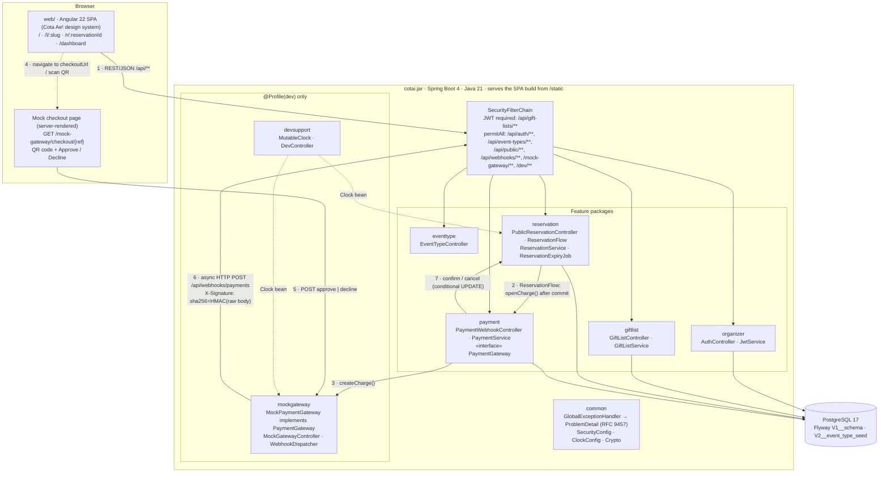
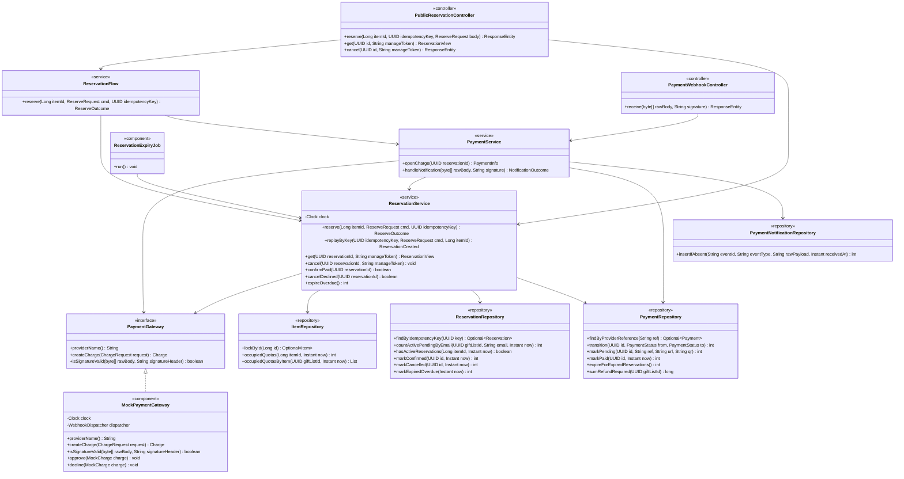
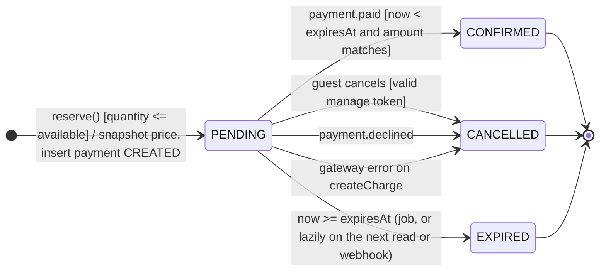
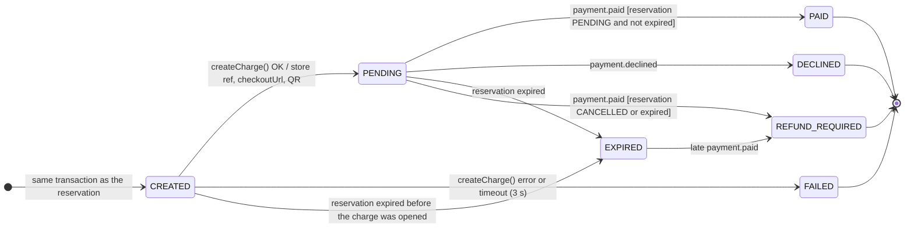
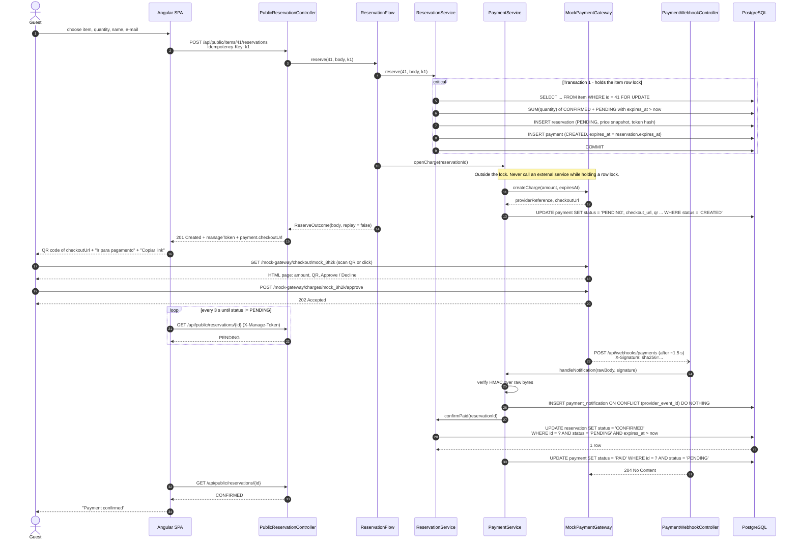
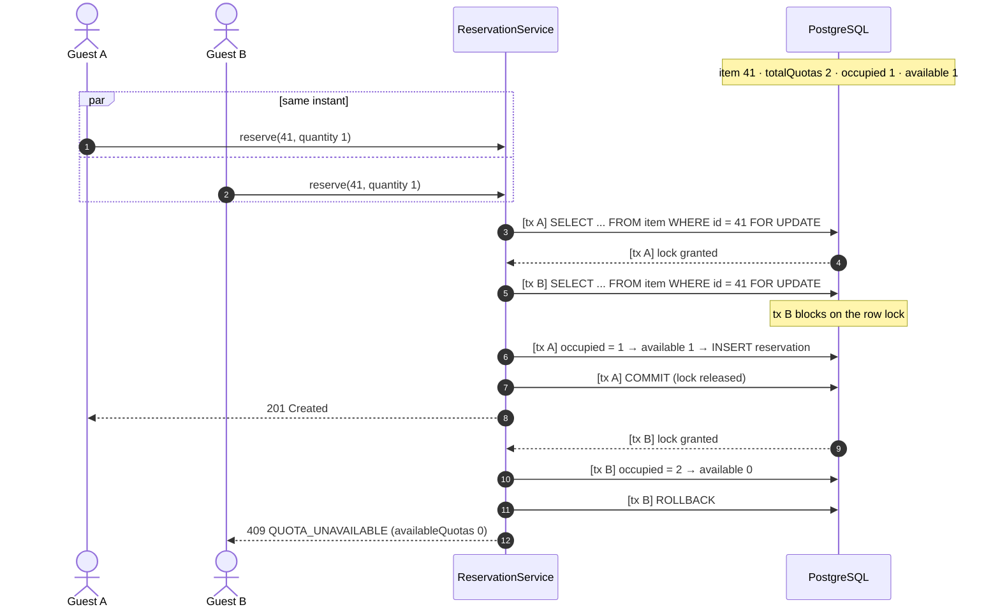
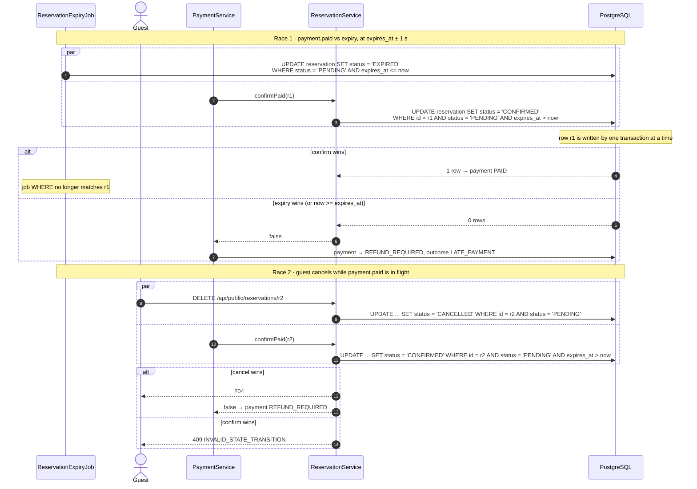

Monorepo · Spring Boot + Angular + REST · v0.3

# Cota Ae!

Lista de presentes com cotas para qualquer evento. O organizador parte de 10 itens sugeridos por tipo de evento, ajusta nome, unidade, preço e cotas, e publica um link. O convidado reserva cotas e paga por QR code ou link num gateway simulado; um webhook assinado confirma a reserva. Todo o código, os diagramas e o OpenAPI estão em inglês; o texto explicativo e a interface estão em português.

Este documento descreve o código da branch `develop`. Onde o código ainda não cumpre o design, a diferença está em [Divergências conhecidas](#divergências-conhecidas).

**Stack:** Java 21 · Spring Boot 4.1 · Spring Data JPA · Lombok · PostgreSQL 17 · Flyway · Testcontainers · Angular 22.2 · OpenAPI 3.1

**Seções:** [Decisões](#decisões) · [Monorepo](#monorepo) · [Arquitetura](#arquitetura) · [Casos de uso](#casos-de-uso) · [Classes](#classes) · [Estados](#estados) · [Pagamento](#pagamento-por-qr-code-ou-link) · [Concorrência](#concorrência) · [Edge cases](#edge-cases) · [Itens padrão](#itens-padrão-por-tipo-de-evento) · [Endpoints](#endpoints) · [OpenAPI](#openapi) · [Collections](#collections) · [Front-end](#front-end-e-design-system) · [Divergências](#divergências-conhecidas)

## Decisões

### Decisões da v0.2

- **Confirmação automática.** O pagamento entra por um webhook assinado. A confirmação manual pelo organizador saiu, porque não existe mais Pix fora do sistema.
- **Prazo de 30 min por padrão.** Agora o pagamento é imediato. A cobrança expira no mesmo instante que a reserva; se expirasse depois, pagamentos atrasados seriam garantidos.
- **Pagamento recusado cancela a reserva** e libera as cotas na hora. Para tentar de novo, o convidado faz uma nova reserva. Isso dá uma cobrança por reserva (1:1).
- **Pagamento atrasado não ressuscita a reserva.** O pagamento vira `REFUND_REQUIRED` e aparece no resumo do organizador.
- **Token de gerenciamento no header** (`X-Manage-Token`), não na query string, que vai parar em logs. É guardado como hash SHA-256.
- **`Idempotency-Key` obrigatório** na reserva. Um clique duplo ou um retry de rede não cria duas reservas.
- **`Clock` injetado.** As queries recebem `now` da aplicação, nunca `CURRENT_TIMESTAMP`. No perfil dev, um `MutableClock` permite reproduzir expirações pela collection.
- **`GiftList`, não `List`**, para não colidir com `java.util.List`. Códigos de evento: `WEDDING`, `BABY_SHOWER`, `BARBECUE`, `OTHER`.
- **Testes de integração com Testcontainers (PostgreSQL),** não H2. O H2 não reproduz fielmente o `FOR UPDATE` nem os locks de linha do Postgres, então um teste de concorrência em H2 não prova nada.

### O que mudou na v0.3 (alinhamento com o código)

- **Nome público Cota Ae!** O repositório, o pacote Java (`dev.cotai`) e o JAR (`cotai.jar`) continuam `cotai`; endpoints, entidades e campos não mudam por causa da marca.
- **`ReservationFlow`** orquestra "reservar e depois abrir a cobrança", sem transação própria. É o que garante o commit antes da chamada externa.
- **Token de gerenciamento derivado:** `HMAC-SHA256(MANAGE_TOKEN_SECRET, Idempotency-Key)`. O banco guarda só o SHA-256 do token, e o replay (EC04, EC06) consegue devolver o mesmo token. Trocar o segredo invalida os tokens já emitidos.
- **`ReserveOutcome(body, replay)`** diz ao controller se responde 201 ou 200.
- **Pagamento CREATED → EXPIRED** pelo job, para o caso de a JVM cair entre o commit e o `createCharge()`.
- **`publish()` também recusa data de evento no passado** (EVENT_DATE_IN_PAST).
- **`payment.paid` de um pagamento já PAID com outro `eventId`** vira DUPLICATE (EC30).
- **Sem classe `Money`:** dinheiro é sempre `long` em centavos.
- **Front em `core/`, `features/` e `shared/`**, com o design system Cota Ae! (seção [Front-end e design system](#front-end-e-design-system)).

## Monorepo

Um repositório, um JAR. O POM pai builda `api/` e `web/`; em produção o build do Angular vai para `static/` dentro do JAR, então não existe CORS em produção.

```
cotai/
├── pom.xml                              # parent: module api (+ web unless -DskipWeb)
├── docker-compose.yml                   # postgres:17
├── README.md
├── AGENTS.md                            # rules for coding agents (UI: Cota Ae! design system)
├── .github/workflows/ci.yml             # api verify (Testcontainers) + web build/test
├── analise_modelo_e_design/             # Astah model (.asta)
├── docs/
│   ├── api/
│   │   ├── openapi.yaml                 # contract, source of truth
│   │   ├── collections/                 # PENDING: Postman + Insomnia (section Collections)
│   │   └── scripts/race-last-quota.sh   # real concurrency, parallel curl
│   ├── design/design-spec.md            # this file
│   └── design-system/                   # Cota Ae!: brand, mobile-first, components, copy, a11y, QA
├── api/
│   ├── pom.xml                          # Lombok, Spring Security JWT, Flyway, Thymeleaf, ZXing
│   └── src/
│       ├── main/java/dev/cotai/
│       │   ├── organizer/               # Organizer, AuthController, JwtService
│       │   ├── eventtype/               # EventType, TemplateItem, EventTypeController
│       │   ├── giftlist/                # GiftList, Item, GiftListService, GiftListController,
│       │   │                            #   PublicGiftListController, SlugGenerator
│       │   ├── reservation/             # Reservation, ReservationFlow, ReservationService, ReservationExpiryJob
│       │   ├── payment/                 # Payment, PaymentGateway, PaymentService, PaymentWebhookController
│       │   ├── mockgateway/             # @Profile("dev"): MockPaymentGateway, MockGatewayController, WebhookDispatcher
│       │   ├── devsupport/              # @Profile("dev"): MutableClock, DevController
│       │   └── common/                  # GlobalExceptionHandler, ErrorCode, BusinessException,
│       │                                #   SecurityConfig, ClockConfig, AppProperties, Crypto, SpaForwardController
│       ├── main/resources/
│       │   ├── application.yml
│       │   ├── application-dev.yml      # mock-gateway.*
│       │   ├── templates/mock-checkout.html
│       │   └── db/migration/
│       │       ├── V1__schema.sql
│       │       └── V2__event_type_seed.sql
│       └── test/java/dev/cotai/
│           ├── CotaiApiApplicationIT.java        # context + Flyway + schema validation
│           ├── TestcontainersConfiguration.java
│           ├── giftlist/SlugGeneratorTest.java
│           └── reservation/MutableClockTest.java
│           # PENDING: ReservationConcurrencyIT (50 threads, 10 quotas), IdempotencyRaceIT,
│           #   ConfirmVsExpireRaceIT, CancelVsPaidRaceIT, PaymentWebhookIT, GatewayFailureIT
└── web/
    ├── pom.xml                          # frontend-maven-plugin: npm ci + ng build -> /static in the jar
    ├── package.json                     # Angular 22.2, Vitest
    ├── proxy.conf.json                  # /api, /mock-gateway -> localhost:8080
    ├── public/brand/                    # Cota Ae! logos (interpretive SVGs)
    └── src/
        ├── styles.scss                  # @use styles/cotai-theme
        ├── styles/                      # cotai-theme.css, _design-tokens.scss
        └── app/
            ├── core/                    # models, ApiService, copy/ui-copy.ts
            ├── features/                # home, gift-list (/l/:slug), reservation (/r/:id), dashboard
            └── shared/cotai-ui/         # cotai-button, cotai-card, cotai-status-badge, cotai-progress
```

## Arquitetura

Os números nas setas seguem a ordem do fluxo de pagamento. O gateway simulado roda dentro do mesmo JAR, mas chama o webhook por HTTP, como um provedor real faria. Por isso a chamada passa pelo filtro de segurança e pela verificação de assinatura.



### Para o Astah

1. Um fluxograma não é UML. No Astah, este diagrama vira **dois**: um **diagrama de componentes** e um **diagrama de implantação**.
2. **Componentes:** um componente por pacote (`organizer`, `eventtype`, `giftlist`, `reservation`, `payment`, `mockgateway`, `devsupport`). `PaymentGateway` é uma interface **fornecida** (bola) por `mockgateway` e **requerida** (soquete) por `payment`. O Mermaid não tem notação de bola e soquete.
3. **Implantação:** nó `Browser` «device»; nó `JVM 21` «executionEnvironment» com o artefato `cotai.jar`; nó `PostgreSQL 17` «database». Caminhos de comunicação: HTTP(S) entre Browser e JVM, JDBC entre JVM e PostgreSQL.
4. O webhook em dev é um **loopback** (JVM → JVM via HTTP). Desenhe como um caminho de comunicação do nó para ele mesmo e anote "dev only; in production the provider is an external node".
5. Marque `mockgateway` e `devsupport` com o estereótipo «profile dev». Em produção eles não existem, e outro adaptador implementaria `PaymentGateway`.
6. A numeração 1–7 é ordem de mensagens, informação de diagrama de sequência. No Astah, tire a numeração das setas do diagrama de componentes; a ordem já está no diagrama da seção F.

## Casos de uso

O Mermaid não tem notação de caso de uso. Este diagrama é um fluxograma que reproduz a estrutura, ou seja, atores, fronteira e relações, para servir de referência ao redesenho no Astah. A tabela logo abaixo do diagrama é a fonte da verdade.


| ID | Use case | Actor | Precondition | Exception flows (error code) |
| --- | --- | --- | --- | --- |
| UC01 | Sign up / Log in | Organizer | — | E-mail taken (EMAIL_ALREADY_REGISTERED); wrong credentials (INVALID_CREDENTIALS, same message for unknown e-mail) |
| UC02 | Create gift list from event type | Organizer | Logged in | Event date in the past (EVENT_DATE_IN_PAST); more than 100 items (VALIDATION_FAILED) |
| UC03 | Customize items | — (included) | Inside UC02 | Price ≤ 0 or quotas \< 1 (VALIDATION_FAILED) |
| UC04 | Publish gift list | Organizer | List in DRAFT | No active items (LIST_HAS_NO_ITEMS); event date in the past (EVENT_DATE_IN_PAST); not DRAFT (INVALID_STATE_TRANSITION) |
| UC05 | Edit / archive item | Organizer | List not CLOSED | Quotas below occupied (QUOTAS_BELOW_OCCUPIED); archive with active reservations (ITEM_HAS_ACTIVE_RESERVATIONS) |
| UC06 | View collection summary | Organizer | Owner of the list | Other organizer's list → 404 |
| UC07 | Close gift list | Organizer | List PUBLISHED | Not PUBLISHED (INVALID_STATE_TRANSITION) |
| UC08 | View gift list by link | Guest | List PUBLISHED or CLOSED | DRAFT or unknown slug → 404 |
| UC09 | Reserve quotas | Guest | List accepts reservations | Not enough quotas (QUOTA_UNAVAILABLE); closed or past date (LIST_NOT_ACCEPTING_RESERVATIONS); > 3 pending per e-mail (TOO_MANY_PENDING_RESERVATIONS); key reused with another body (IDEMPOTENCY_KEY_MISMATCH) |
| UC10 | Check availability | — (included) | Item row locked | — |
| UC11 | Open payment charge | — (included) | Reservation committed | Gateway error or timeout → reservation CANCELLED, payment FAILED (PAYMENT_GATEWAY_UNAVAILABLE) |
| UC12 | Pay via QR code / link | Guest, Payment Gateway | Payment PENDING | Charge expired → 410 on the gateway; declined → reservation CANCELLED |
| UC13 | Track reservation | Guest | Has manage token | Wrong token → 404 |
| UC14 | Cancel own reservation | Guest | Reservation PENDING | Not PENDING (INVALID_STATE_TRANSITION); wrong token → 404 |
| UC15 | Process payment notification | Payment Gateway | — | Duplicate event → no-op; unknown reference or amount mismatch → stored as REJECTED, 204 |
| UC16 | Verify signature | — (included) | Raw body available | Invalid or missing (INVALID_SIGNATURE, 401) |
| UC17 | Flag refund for late payment | — (extends UC15) | Reservation not PENDING or expired | — |
| UC18 | Expire overdue reservations | Scheduler | Every 60 s | Runs on N instances at once → idempotent, no effect twice |

### Para o Astah

1. Atores como bonecos e casos de uso como elipses, dentro de uma fronteira de sistema chamada `Cota Ae!`. O Mermaid só consegue desenhar retângulos e pílulas.
2. Atores primários à esquerda (Organizer, Guest) e secundários à direita (Payment Gateway com «system», Scheduler).
3. **Scheduler como ator é discutível.** Se o professor não aceitar o tempo como ator, remova-o e coloque uma nota em UC18: "triggered every 60 s by @Scheduled". Decida isso antes de entregar.
4. **Direção das setas.** «include»: tracejada, saindo do caso base para o incluído (UC09 → UC10, UC09 → UC11, UC02 → UC03, UC15 → UC16). «extend»: tracejada, saindo da extensão para o caso base (UC17 → UC15). O diagrama acima já segue essa direção.
5. **Ponto de extensão.** No UC15, adicione o compartimento "extension points: afterConfirmAttempt" e uma nota de condição na seta «extend»: `{reservation not PENDING or expiresAt <= now}`. O Mermaid não tem compartimento de ponto de extensão.
6. **UC01 é pré-condição, não «include».** Não ligue UC02–UC07 a "Log in" com «include»; é um erro comum e costuma tirar ponto.
7. UC12 tem dois atores: o Guest inicia e o Payment Gateway participa. Associe os dois sem seta de navegação.
8. Não existe generalização entre Guest e Organizer. Um organizador que reserva cotas age como Guest, sem login.

## Classes

### Modelo de domínio (entidades JPA)

A direção das setas segue o mapeamento JPA: aponta do lado que guarda a chave estrangeira. O disponível de um item não é atributo persistido; é derivado das reservas.


| Class | Constraint (put as OCL note in Astah) | Enforced by |
| --- | --- | --- |
| Organizer | email {unique}, lower-cased before save | UNIQUE index on lower(email) |
| TemplateItem | (eventType, position) {unique}; position in 1..10 | UNIQUE + CHECK |
| GiftList | slug {unique}; status = PUBLISHED implies items->select(not archived)->notEmpty() | UNIQUE; GiftList.publish() |
| GiftList | reservationTtlMinutes in 10..1440 | CHECK + Bean Validation |
| Item | totalQuotas >= 1; unitPriceCents >= 1 | CHECK |
| Item | /availableQuotas = totalQuotas - reservations->select(status = CONFIRMED or (status = PENDING and expiresAt > now)).quantity->sum() | Derived; computed under row lock |
| Item | inv: /availableQuotas >= 0 | SELECT … FOR UPDATE in reserve() and updateItem() |
| Reservation | quantity >= 1; amountCents = quantity * unitPriceCents | CHECK |
| Reservation | unitPriceCents is a snapshot of item.unitPriceCents at creation {readOnly} | No setter; column updatable = false |
| Reservation | idempotencyKey {unique}; manageTokenHash = sha256(token); token = HMAC-SHA256(MANAGE_TOKEN_SECRET, idempotencyKey) | UNIQUE; o replay recalcula o mesmo token sem guardá-lo |
| Payment | reservation {unique}; providerReference {unique}; amountCents = reservation.amountCents; expiresAt = reservation.expiresAt | UNIQUE; set in the same transaction |
| PaymentNotification | providerEventId {unique} | INSERT … ON CONFLICT DO NOTHING |

### Camada de aplicação

Controllers, services, repositories e o ponto de troca do gateway. DTOs ficam fora do diagrama, porque são records sem comportamento. `ReserveOutcome(body, replay)` diz ao controller se responde 201 (criou) ou 200 (replay da mesma `Idempotency-Key`). `ReservationService` depende de `PaymentGateway` só para gravar `providerName()` no pagamento CREATED, que nasce na mesma transação da reserva.



### Para o Astah

1. **Restrições.** Cole cada linha da tabela acima como nota de restrição (OCL) presa à classe. O Mermaid não desenha `{…}` nem notas ligadas a classes.
2. **Atributo derivado.** Adicione `/availableQuotas : int {derived}` em `Item`. Ele ficou fora do diagrama Mermaid porque lá seria lido como campo persistido.
3. **Nomes de papel nas pontas.** O Mermaid coloca o rótulo no meio da linha. No Astah, os nomes (`items`, `owner`, `eventType`, `item`, `reservation`, `payment`, `templateItems`) vão na ponta oposta à classe dona do atributo.
4. **Linhas tracejadas até os enums.** Elas existem só porque o Mermaid não liga um atributo ao seu tipo. No Astah, apague essas linhas: o atributo tipado (`status : ReservationStatus`) já expressa a relação.
5. **Composições** (losango cheio): `GiftList ◆— Item` e `EventType ◆— TemplateItem`. `Organizer — GiftList` é associação simples, não agregação: apagar um organizador não é um caso de uso.
6. `PaymentNotification → Payment` é **0..1**, porque notificações com referência desconhecida também são gravadas. Não "corrija" para 1.
7. Na camada de aplicação, as setas cheias representam campos `private final` injetados pelo construtor. Por isso são associações e não dependências «use». Se o professor preferir dependência, troque todas, sem misturar.
8. Estereótipos «entity», «enumeration», «interface», «service», «repository», «controller» e «component» precisam ser criados como estereótipos personalizados no Astah. A realização de `PaymentGateway` é tracejada com triângulo vazado.
9. `MutableClock`, `WebhookDispatcher` e os DTOs foram omitidos de propósito. Se o professor pedir completude, coloque-os num diagrama de pacotes separado. `ReservationFlow` entra no diagrama porque é a fronteira entre a transação da reserva e a chamada externa.

## Estados

### Reservation



### Payment



- **Toda transição é um UPDATE condicional** com `WHERE status = <origem>`. Se afetar 0 linhas, outra transação já mudou o estado.
- **EXPIRED tem duas origens**: o job, ou a leitura ou o webhook que encontra uma reserva vencida ainda marcada como PENDING. O GET já devolve o *effective status*.
- **Nenhum estado final tem saída.** Não existe reabrir reserva. Um pagamento atrasado vira REFUND_REQUIRED no *pagamento*, não altera a reserva.
- **O job expira reserva e pagamento na mesma transação.** CREATED → EXPIRED cobre o caso de a JVM cair entre o commit da reserva e o `createCharge()`.

### Para o Astah

1. Escreva as transições no formato UML `event [guard] / action`. O Mermaid trata o rótulo como texto livre, então a sintaxe acima é só aproximada.
2. No pagamento, a decisão entre PAID e REFUND_REQUIRED após `payment.paid` é um **pseudoestado de escolha** (losango) com as duas guardas. No Mermaid ela virou duas setas paralelas.
3. Desenhe as duas máquinas no mesmo diagrama, como regiões ortogonais de "ReservationLifecycle", ou separadas. Não junte os estados numa máquina só: são ciclos de vida de objetos diferentes.

## Pagamento por QR code ou link

A resposta da reserva traz o `checkoutUrl`. A SPA mostra o QR code dessa URL e um botão "Abrir link de pagamento". A página de checkout é do gateway simulado, renderizada pelo Spring, e não da SPA, para imitar um provedor externo de verdade.



A página de checkout simulada mostra o valor, a descrição (`item xN - título da lista`), o QR code gerado no servidor com ZXing e os botões Approve e Decline. Approve ou Decline num charge vencido devolve 410 CHARGE_EXPIRED.

- **`ReservationFlow` orquestra reservar e abrir a cobrança.** Ele não é transacional: `ReservationService.reserve()` faz commit e libera o lock, e só depois o `PaymentService.openCharge()` chama o gateway. Se as duas chamadas ficassem no mesmo bean, a chamada interna não passaria pelo proxy do Spring e as transações se misturariam.
- **O QR code aponta para `app.public-base-url`.** Com `localhost`, o celular que escanear não abre a página. Na demo, use o IP da rede local.
- **Polling a cada 3 s** em vez de SSE/WebSocket. É mais simples e suficiente, e o mesmo GET serve para a tela "minha reserva".
- **O webhook lê o corpo cru** (`byte[]`). Se o Spring desserializar para DTO antes de validar o HMAC, a assinatura deixa de bater.
- **Atraso e duplicação configuráveis** no gateway simulado: `mock-gateway.webhook-delay-ms` e `mock-gateway.duplicate-deliveries`. Servem para demonstrar a idempotência ao vivo.

## Concorrência

### Última cota, dois convidados



### Corridas de transição de estado



### Para o Astah

1. Os fragmentos `par`, `alt`, `loop` e `critical` existem em UML. Recrie-os com os mesmos operandos e guardas.
2. Os prefixos `[tx A]` e `[tx B]` substituem duas linhas de vida de transação. No Astah, prefira duas linhas de vida `:Transaction A` e `:Transaction B` entre o Service e o PostgreSQL.
3. O bloqueio da tx B deve aparecer como uma **barra de ativação suspensa** (ou uma restrição de duração `{blocked until A commits}`). O Mermaid só consegue mostrar isso como nota.
4. A mensagem do webhook é **assíncrona** (seta aberta). Confira que o Astah não a converta em síncrona ao redesenhar.

## Edge cases

**Situação:** os testes de integração e as collections citados na coluna "Onde" ainda não existem no repositório (veja [Divergências conhecidas](#divergências-conhecidas)). O comportamento descrito está implementado, exceto os pontos listados lá.

A última coluna diz onde cada caso é reproduzido. collection roda no Postman ou no Insomnia. JUnit é teste de integração com Testcontainers. script é o `race-last-quota.sh`. manual precisa de uma pessoa, e são esses que não dá para automatizar nem desenhar no Mermaid.

| ID | Cenário | Comportamento esperado | Onde |
| --- | --- | --- | --- |
| EC01 | Dois convidados disputam a última cota no mesmo instante | Exatamente 1 × 201 e o resto 409 QUOTA_UNAVAILABLE | JUnit script A collection é sequencial e não reproduz isso |
| EC02 | Quantidade maior que o disponível | 409 com `availableQuotas` | collection 05 |
| EC03 | Quantidade 0 ou negativa | 400 VALIDATION_FAILED com o campo | collection 05 |
| EC04 | Clique duplo / retry com a mesma Idempotency-Key | 200 com a mesma reserva | collection 03 |
| EC05 | Mesma key, corpo diferente | 422 IDEMPOTENCY_KEY_MISMATCH (checado antes da disponibilidade) | collection 05 |
| EC06 | Duas requisições simultâneas com a mesma key | Uma insere; a outra bate no UNIQUE, relê e devolve replay 200 | JUnit IdempotencyRaceIT |
| EC07 | Gateway fora do ar ou timeout no createCharge | Reserva CANCELLED, pagamento FAILED, 502. As cotas voltam na hora | JUnit GatewayFailureIT |
| EC08 | Webhook duplicado (mesmo eventId) | 204, nenhuma mudança de estado | collection 06 |
| EC09 | Assinatura inválida ou ausente | 401 INVALID_SIGNATURE | collection 06 |
| EC10 | Webhook com referência desconhecida | 204 e outcome REJECTED, para o provedor parar de reenviar | collection 06 |
| EC11 | Webhook com valor diferente do cobrado | 204, REJECTED; a reserva continua PENDING | collection 07 |
| EC12 | Pagamento chega depois do prazo | Reserva EXPIRED, pagamento REFUND_REQUIRED, valor em `refundRequiredCents` | collection 07 (dev clock) |
| EC13 | payment.paid e expiração no mesmo segundo | Exatamente uma transição vence | JUnit ConfirmVsExpireRaceIT |
| EC14 | Convidado cancela enquanto o pagamento é confirmado | Uma vence; se o cancelamento vencer, o pagamento vira REFUND_REQUIRED | JUnit CancelVsPaidRaceIT |
| EC15 | Job de expiração parado | O disponível continua correto, porque é calculado por `expiresAt` | collection 07 |
| EC16 | Job rodando em duas instâncias ao mesmo tempo | Idempotente; nenhuma reserva é expirada duas vezes. Não precisa de ShedLock | JUnit |
| EC17 | Organizador reduz cotas abaixo do ocupado | 409 QUOTAS_BELOW_OCCUPIED | collection 05 |
| EC18 | Organizador muda o preço com reservas pendentes | As pendentes mantêm o preço antigo (snapshot); o valor da cobrança não muda | JUnit |
| EC19 | Arquivar item com reservas ativas | 409 ITEM_HAS_ACTIVE_RESERVATIONS | collection 05 |
| EC20 | Lista em DRAFT acessada pelo link | 404 | collection 02 |
| EC21 | Token de gerenciamento errado | 404 (sem revelar se a reserva existe) | collection 04 |
| EC22 | Cancelar reserva que não está PENDING | 409 INVALID_STATE_TRANSITION | collection 04 |
| EC23 | Lista fechada | 409 LIST_NOT_ACCEPTING_RESERVATIONS; pendentes ainda podem ser pagas até expirar | collection 07 |
| EC24 | Data do evento: 22:30 em São Paulo já é amanhã em UTC | "Hoje" é calculado em `app.zone`, não em UTC | JUnit com Clock fixo em `2026-12-01T01:30Z` |
| EC25 | Alguém reserva todas as cotas e não paga | No máximo 3 PENDING por e-mail por lista (429), e o prazo de 30 min limita o estrago. **Limitação conhecida:** o e-mail não é verificado, então dá para burlar trocando de e-mail. Rate limit por IP fica fora do escopo | JUnit |
| EC26 | Organizador acessa a lista de outro organizador | 404, não 403 | JUnit (precisa de dois usuários) |
| EC27 | Celular escaneia um QR que aponta para localhost | A página não abre; configure `app.public-base-url` com o IP da rede local | manual |
| EC28 | Disponível desatualizado na tela do convidado | A SPA mostra "Essa cota acabou de ser reservada" no 409 e recarrega a lista | manual (duas abas) |
| EC29 | Convidado fecha a aba durante o pagamento | O webhook confirma mesmo assim; ao reabrir `/r/:id`, a tela mostra CONFIRMED | manual |
| EC30 | Provedor reenvia `payment.paid` de um pagamento já PAID com outro `eventId` | 204 e outcome DUPLICATE; nada muda | collection 06 |
| EC31 | A JVM cai entre o commit da reserva e o `createCharge()` | O pagamento fica em CREATED e o job o expira junto com a reserva | JUnit |

## Itens padrão por tipo de evento

São 10 sugestões por tipo, gravadas na migration `V2__event_type_seed.sql`, para `BARBECUE` (Churrasco), `BABY_SHOWER` (Chá de bebê), `WEDDING` (Casamento) e `OTHER` (Outro, sem sugestões). O organizador edita tudo antes de criar a lista. Os códigos são em inglês, e os nomes dos itens ficam em português porque são dados exibidos ao usuário. Os preços são exemplos. Todos os tipos usam 30 min de prazo por padrão.

## Endpoints

| Route | Auth | Responses |
| --- | --- | --- |
| POST/api/auth/register | public | 201 · 400 · 409 |
| POST/api/auth/login | public | 200 · 400 · 401 |
| GET/api/event-types | public | 200 |
| GET/api/event-types/{eventTypeCode}/template-items | public | 200 · 404 |
| GET/api/gift-lists | bearer | 200 · 401 |
| POST/api/gift-lists | bearer | 201 · 400 · 401 · 404 · 422 |
| GET/api/gift-lists/{giftListId} | bearer | 200 · 401 · 404 |
| PATCH/api/gift-lists/{giftListId} | bearer | 200 · 400 · 401 · 404 · 409 |
| POST/api/gift-lists/{giftListId}/publish | bearer | 200 · 401 · 404 · 409 · 422 |
| POST/api/gift-lists/{giftListId}/close | bearer | 200 · 401 · 404 · 409 |
| POST/api/gift-lists/{giftListId}/items | bearer | 201 · 400 · 401 · 404 · 409 |
| PUT/api/gift-lists/{giftListId}/items/{itemId} | bearer | 200 · 400 · 401 · 404 · 409 |
| DELETE/api/gift-lists/{giftListId}/items/{itemId} | bearer | 204 · 401 · 404 · 409 |
| GET/api/gift-lists/{giftListId}/summary | bearer | 200 · 401 · 404 |
| GET/api/public/gift-lists/{slug} | public | 200 · 404 |
| POST/api/public/items/{itemId}/reservations | public | 201 · 200 · 400 · 404 · 409 · 422 · 429 · 502 |
| GET/api/public/reservations/{reservationId} | public | 200 · 404 |
| DELETE/api/public/reservations/{reservationId} | public | 204 · 404 · 409 |
| POST/api/webhooks/payments | public | 204 · 400 · 401 |
| GET/mock-gateway/checkout/{providerReference} | dev only | 200 · 404 |
| GET/mock-gateway/charges/{providerReference} | dev only | 200 · 404 |
| POST/mock-gateway/charges/{providerReference}/approve | dev only | 202 · 404 · 409 · 410 |
| POST/mock-gateway/charges/{providerReference}/decline | dev only | 202 · 404 · 409 · 410 |
| GET/dev/clock | dev only | 200 |
| POST/dev/clock/advance | dev only | 200 |
| POST/dev/clock/reset | dev only | 200 |
| POST/dev/jobs/expire-reservations | dev only | 200 |

## OpenAPI

O contrato fica em [`docs/api/openapi.yaml`](../api/openapi.yaml) e é a fonte da verdade dos endpoints, DTOs e códigos de erro. A cópia que existia neste arquivo foi removida para não divergir. Os tipos do Angular em `web/src/app/core/models/` ainda são escritos à mão; gerá-los a partir do OpenAPI está pendente.

## Collections

**Pendente no repositório.** As collections foram desenhadas na v0.2 (59 requests em 8 pastas, com testes e webhooks assinados por HMAC-SHA256), mas `docs/api/collections/` ainda não existe. Quando forem adicionadas, devem usar o nome Cota Ae! e seguir esta ordem, com a API no perfil `dev`:

| Pasta | Requests |
| --- | --- |
| **00 Setup** | Register organizer · Login |
| **01 Event types** | List event types · Get template items · Template items of OTHER are empty |
| **02 Organizer - gift lists** | Create gift list from template · Public view of a DRAFT list is 404 · Publish gift list · Get my gift list · List my gift lists · Update item (name and price) · Add item · Archive item without reservations |
| **03 Guest - reserve and pay** | Get public gift list · Reserve 1 quota · Replay with the same Idempotency-Key · Get reservation (manage token) · Open checkout page (QR code) · Get mock charge · Approve charge on the mock gateway · Wait for CONFIRMED · Organizer summary |
| **04 Guest - cancel** | Reserve 1 quota (to cancel) · Cancel with a wrong token is 404 · Cancel reservation · Cancel twice is 409 · Cancelled quota is available again |
| **05 Edge cases - validation and conflicts** | Login with wrong password is 401 · Organizer endpoint without token is 401 · Quantity 0 is 400 · Missing Idempotency-Key is 400 · More quotas than available is 409 · Reused Idempotency-Key with another body is 422 · Reserve the last quota · Sold out item is 409 · Reduce quotas below occupied is 409 · Archive item with active reservations is 409 · Publish twice is 409 · Decline the last quota's charge · Wait for CANCELLED after decline |
| **06 Webhooks - signed by the collection** | Paid webhook for an already PAID payment · Exact same webhook again (same eventId) · Summary unchanged after duplicates · Invalid signature is 401 · Unknown reference is accepted and ignored |
| **07 Edge cases - time (dev clock)** | Reset clock · Reserve 1 quota of the second item · Amount mismatch webhook is ignored · Still PENDING after mismatch · Advance clock 31 minutes · Expired quota is free before the job runs · Approve expired charge is 410 · Late paid webhook · Late payment: EXPIRED + REFUND_REQUIRED · Run expiry job · Summary shows the refund · Close gift list · Reserve on a closed list is 409 · Reset clock (cleanup) |

## Front-end e design system

A interface segue o design system **Cota Ae!** (`docs/design-system/`, regras para agentes em `AGENTS.md`). Ele é mobile-first: o CSS parte de 320 px sem media query e só expande com `min-width` em 40rem, 48rem e 64rem.

| Peça | Onde | Uso |
| --- | --- | --- |
| Tokens e tema | `web/src/styles/cotai-theme.css`, `_design-tokens.scss` | Importados em `styles.scss`; valem dentro de `.cotai-app` |
| Checkout simulado | `api/src/main/resources/templates/mock-checkout.html` | Mesmos tokens copiados no `<style>`, porque a página é servida pela API e não pelo Angular |
| Componentes | `web/src/app/shared/cotai-ui/` | `cotai-button`, `cotai-card`, `cotai-status-badge`, `cotai-progress` |
| Marca | `web/public/brand/` | Logos e ícone em SVG, interpretativos; a referência aprovada é `docs/design-system/references/identidade-aprovada.png` |
| Textos de status e erro | `web/src/app/core/copy/ui-copy.ts` | Traduz `code` do Problem Detail e o status da reserva para o texto de `UI_COPY.md` |

Rotas existentes: `/` (início), `/l/:slug` (lista pública), `/r/:reservationId` (minha reserva) e `/dashboard` (placeholder). As telas do organizador (`/login`, `/register`, `/lists/new`, `/lists/:id`) ainda não existem no Angular, embora o `SpaForwardController` já encaminhe essas rotas.

No QUOTA_UNAVAILABLE (EC28), a lista pública fecha o formulário, mostra "Essa cota acabou de ser reservada. Atualizamos os números." e recarrega a disponibilidade.

## Divergências conhecidas

O código ainda não cumpre estes pontos do design. São correções a fazer no código, não mudanças de design.

| Ponto do design | Situação no código |
| --- | --- |
| Estado e preço congelado só mudam por método de domínio ou `UPDATE` condicional | `@Setter` do Lombok na classe inteira de `Reservation`, `GiftList`, `Item` e `Payment` permite `setStatus`, `setTotalQuotas` e `setUnitPriceCents` |
| Timeout de 3 s no `createCharge()` | `payment.gateway-timeout-ms` existe em `PaymentProperties`, mas não é usado |
| Um clique duplo não cria duas reservas (EC04) | A SPA gera uma `Idempotency-Key` nova a cada envio; o botão fica desabilitado durante o envio, mas a key deveria nascer com o formulário |
| Ao reabrir `/r/:id`, a tela mostra o status (EC29) | O `manageToken` fica em `sessionStorage`, que some ao fechar a aba |
| QR code da URL de checkout | A SPA gera o QR em `api.qrserver.com`, que recebe a URL e exige internet |
| Fora do perfil `dev`, outro adaptador implementa `PaymentGateway` | Não há adaptador; sem `dev` a aplicação não sobe |
| Testes de integração e collections | Só existem o teste de contexto (`CotaiApiApplicationIT`) e dois testes unitários; as collections não estão no repositório |
