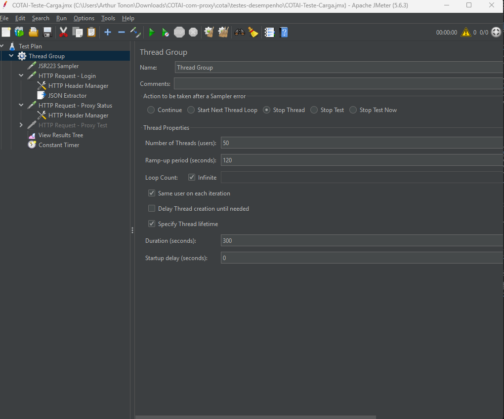

# COTAI — README de Testes de Carga e Desempenho

## 1. Objetivo

Executar e documentar testes de carga do backend do COTAI com Apache JMeter, medindo tempos de resposta, percentuais, vazão (*throughput*) e taxa de erros em três cenários: **10, 25 e 50 usuários virtuais**.

> **Escopo:** os testes de carga descritos aqui exercitam `POST /api/auth/login` e `GET /api/proxy/status`. O endpoint `GET /api/proxy/test`, que acessa `https://example.com` por meio do Squid, deve permanecer **desabilitado durante a carga**. Portanto, os resultados de carga **não medem a capacidade de encaminhamento HTTPS do Squid**.

## 2. Pré-requisitos

- **Windows com PowerShell**.
- **Docker Desktop** iniciado, com os containers `cotai-postgres` e `cotai-proxy` ativos e saudáveis.
- **Backend COTAI** iniciado e acessível em `http://localhost:8080`.
- **Apache JMeter 5.6.3** instalado em `C:\Ferramentas\apache-jmeter-5.6.3`.
- **JDK 17** para executar o JMeter (o Java 25 utilizado pelo backend pode permanecer instalado; evite usá-lo no JMeter 5.6.3, pois houve incompatibilidade com o Groovy).
- Conta de teste válida no COTAI (criada), com e-mail e senha.
- Arquivo de plano de testes `COTAI-Teste-Carga.jmx` previamente configurado.
- Recursos suficientes no computador para executar backend, containers e JMeter simultaneamente.

**Segurança:** use uma conta dedicada de testes. Nos comandos históricos abaixo, a senha é passada por `-Jcotai.password=...`, o que pode expô-la na linha de comando do processo. Evite contas reais e senhas reutilizadas.

## 3. Caminhos e arquivos

Os caminhos abaixo correspondem ao ambiente Windows utilizado nos testes. Ajuste-os se os programas ou o projeto estiverem em outras pastas.

| Item | Caminho |
|---|---|
| Diretório de trabalho dos testes | `C:\...\cotai\testes-desempenho` |
| Executável do JMeter | `C:\Ferramentas\apache-jmeter-5.6.3\bin\jmeter.bat` |
| Plano funcional original | `C:\...\cotai\testes-desempenho\COTAI-Teste-Proxy.jmx` |
| Plano de carga | `C:\...\cotai\testes-desempenho\COTAI-Teste-Carga.jmx` |
| Resultados de 10 usuários | `C:\...\cotai\testes-desempenho\resultados\resultado-carga-10-v3.jtl` |
| Resultados de 25 usuários | `C:\...\cotai\testes-desempenho\resultados\resultado-carga-25.jtl` |
| Resultados de 50 usuários | `C:\...\cotai\testes-desempenho\resultados\resultado-carga-50.jtl` |
| Relatório HTML de 10 usuários | `C:\...\cotai\testes-desempenho\relatorio\relatorio-carga-10-v3\index.html` |
| Relatório HTML de 25 usuários | `C:\...\cotai\testes-desempenho\relatorio\relatorio-carga-25\index.html` |
| Relatório HTML de 50 usuários | `C:\...\cotai\testes-desempenho\relatorio\relatorio-carga-50\index.html` | 
| Backend (caminho utilizado anteriormente) | `C:\...\cotai\backend` |
| JDK 17 | Dentro de `C:\Program Files\Eclipse Adoptium\jdk-17...` (nome exato depende da instalação) |

**Atenção:** os arquivos `.jtl` e as pastas de relatório só existirão após as respectivas execuções. Não execute novos testes gravando sobre um `.jtl` antigo: o JMeter pode acrescentar registros e misturar rodadas.

## 4. Preparar o ambiente

### 4.1 Verificar Docker

Abra o PowerShell:

```powershell
docker ps
```


Confirme que `cotai-postgres` e `cotai-proxy` aparecem como ativos (*healthy*). Se estiverem parados, inicie os serviços usando o arquivo Compose do projeto, a partir do diretório correto:

```powershell
cd "C:\...\cotai\backend" (Insira o caminho correto)
docker compose up -d
```


## 4.2.1 Configuração das versões do Java

O projeto COTAI utiliza versões diferentes do Java para executar o backend e o Apache JMeter.

Componente                     Java utilizado
-----------------------------------------------
Backend Spring Boot            Java 25 (JDK)
Apache JMeter 5.6.3            Java 17 (JDK)

Importante: configure o Java separadamente em cada terminal PowerShell. As variáveis de ambiente definidas com $env: são aplicadas à sessão atual.

*Para o backend:*
```
$java25 = Get-ChildItem "C:\Program Files\Eclipse Adoptium" -Directory |
    Where-Object { $_.Name -match '^jdk-25\.' } |
    Select-Object -First 1

if (-not $java25) {
    throw "JDK 25 não encontrado."
}

$env:JAVA_HOME = $java25.FullName
$env:PATH = "$env:JAVA_HOME\bin;$env:PATH"
```

Não execute o backend e o JMeter no mesmo terminal sem ajustar novamente o JAVA_HOME e o PATH


### 4.2.2 Iniciar o backend

No terminal destinado ao backend, entre na pasta do projeto e configure as variáveis de ambiente necessárias à sua instalação do proxy **antes de iniciar o Spring Boot**. Não coloque a senha do proxy no README nem no repositório.

```powershell
cd "C:\...\cotai\backend" (Insira o caminho correto)

$env:COTAI_PROXY_ENABLED = "true"
$env:PROXY_USERNAME = "cotai_proxy"
$senhaProxy = Read-Host "Senha do proxy Squid" -AsSecureString # (A senha se encontra em ../backend/.env)
$env:PROXY_PASSWORD = [System.Net.NetworkCredential]::new("", $senhaProxy).Password
Remove-Variable senhaProxy

# Necessário neste ambiente de desenvolvimento para autenticação Basic em CONNECT HTTPS.
$env:JAVA_TOOL_OPTIONS = "-Djdk.http.auth.tunneling.disabledSchemes="

.\mvnw.cmd -DskipWeb spring-boot:run
```

Aguarde o backend ficar disponível em `http://localhost:8080`. O terminal do backend deve permanecer aberto durante o teste. A configuração `jdk.http.auth.tunneling.disabledSchemes` é específica deste ambiente de desenvolvimento; não a aplique indiscriminadamente em produção.

### 4.2.3 Selecionar Java 17 para o JMeter

**Em outro PowerShell**:

```powershell
$java17 = Get-ChildItem "C:\Program Files\Eclipse Adoptium" -Directory |
    Where-Object { $_.Name -match '^jdk-17\.' } |
    Select-Object -First 1

if (-not $java17) { throw "JDK 17 não encontrado em Eclipse Adoptium." }

$env:JAVA_HOME = $java17.FullName
$env:PATH = "$env:JAVA_HOME\bin;$env:PATH"
java -version
```

A saída deve indicar **Java 17**. Essa configuração vale para o terminal atual.

### 4.2.4 Iniciar o frontend

**Em outro PowerShell**:

```powershell
npm ci
npm install
npm start
```

## 5. Configurar o plano de carga no JMeter

Abra a interface gráfica para configurar e salvar o plano:

```powershell
& "C:\Ferramentas\apache-jmeter-5.6.3\bin\jmeter.bat"
```

Abra `C:\...\cotai\teste-desempenho\COTAI-Teste-Carga.jmx`. (O caminho correto)

A estrutura esperada é:

```text
Test Plan
└── Thread Group
    ├── JSR223 Sampler (monta LOGIN_JSON)
    ├── HTTP Request - Login
    │   ├── HTTP Header Manager (Content-Type: application/json)
    │   └── JSON Extractor (JWT_TOKEN = $.accessToken)
    ├── HTTP Request - Proxy Status
    │   └── HTTP Header Manager (Authorization: Bearer ${JWT_TOKEN})
    ├── HTTP Request - Proxy Test [DESABILITADO]
    └── Constant Timer (1000 ms)
```

O `Constant Timer` pode aparecer em outra posição dentro do mesmo `Thread Group`; sua abrangência depende da hierarquia do JMeter. Para comparar os cenários, mantenha o mesmo escopo e o mesmo valor em todas as rodadas.

**Configurações dos HTTP Requests:**

- Login: `POST http://localhost:8080/api/auth/login`, corpo `${LOGIN_JSON}`, `Content-Type: application/json`.
- Proxy Status: `GET http://localhost:8080/api/proxy/status`, `Authorization: Bearer ${JWT_TOKEN}`.
- Proxy Test: `GET http://localhost:8080/api/proxy/test`, **desabilitado durante a carga**.

O `JSR223 Sampler` prepara os dados de login. Seu tempo de execução não deve ser confundido com latência de requisição HTTP.

### Cenários

Em `Thread Group` é o local que dirá quantos testes de carga será feitos. Quanto maior o numero de usuários (Number of Threads), maior será os segundos
| Cenário        | Number of Threads | Ramp-up | Loop Count           | Specify Thread lifetime / Duration | Startup Delay |
| Carga leve     | 10                | 30 s    | **Infinite** marcado | 120 s                              | 0 s           |
| Carga moderada | 25                | 60 s    | **Infinite** marcado | 180 s                              | 0 s           |
| Carga elevada  | 50                | 120 s   | **Infinite** marcado | 300 s                              | 0 s           |

Em `Thread Group`, marque **Infinite** no campo `Loop Count`, habilite **Specify Thread lifetime** e configure a duração. Salve com `Ctrl + S` **antes** de executar no terminal. Os cenários são executados **separadamente**, ajustando o mesmo plano entre rodadas.



## 6. Executar um teste de carga

Abra um PowerShell com **Java 17** configurado conforme a seção 4.2.3.

O bloco abaixo é reutilizável: altere apenas `$cenario` para `10`, `25` ou `50`, depois de salvar as configurações correspondentes no arquivo `.jmx`.

```powershell
cd "C:\...\cotai\teste-desempenho\resultado" (Insira o caminho correto)

$cenario = "10"  # Alterar para "25" ou "50" na rodada correspondente.
$arquivoJtl = ".\resultado-carga-$cenario-novo.jtl"
$arquivoLog = ".\jmeter-carga-$cenario-novo.log"

if (Test-Path $arquivoJtl) {
    throw "O arquivo $arquivoJtl já existe. Escolha outro nome para não misturar resultados."
}

$email = Read-Host "E-mail da conta de teste COTAI" #Com o backend rodando, é necessário ter um usuário e senha cadastrado no banco de dados
$senhaSegura = Read-Host "Senha da conta de teste COTAI" -AsSecureString #Com o backend rodando, é necessário ter um usuário e senha cadastrado no banco de dados
$senha = [System.Net.NetworkCredential]::new("", $senhaSegura).Password

try {
    & "C:\Ferramentas\apache-jmeter-5.6.3\bin\jmeter.bat" `
        -n `
        -t ".\COTAI-Teste-Carga.jmx" `
        "-Jcotai.email=$email" `
        "-Jcotai.password=$senha" `
        -l $arquivoJtl ` #Exemplo: -l ".\resultado\resultado-carga-10-v3.jtl" `
        -j $arquivoLog   #Exemplo: -j ".\relatorio\jmeter-carga-10-v3.log"
}
finally {
    Remove-Variable senha, senhaSegura -ErrorAction SilentlyContinue
}
```

O JMeter exibirá um resumo com quantidade de amostras, tempo médio e erros. Aguarde o encerramento completo. Não é necessário manter a interface gráfica aberta para executar no modo `-n`.

**Alternativa mais segura para uso futuro:** adaptar o `JSR223 Sampler` para ler a senha de uma variável de ambiente do processo, evitando expô-la no argumento `-J`.

## 7. Gerar e abrir o relatório HTML

Exemplo para uma nova execução de **10 usuários** (`resultado-carga-10-novo.jtl`):

```powershell
cd "C:\...\cotai\teste-desempenho\resultado" (Insira o caminho correto)

& "C:\Ferramentas\apache-jmeter-5.6.3\bin\jmeter.bat" `
    -g ".\resultado\resultado-carga-10-novo.jtl" `
    -o ".\resultado\relatorio-carga-10-novo"

Start-Process ".\relatorio\relatorio-carga-10-novo\index.html"
```

Para **25** ou **50** usuários, troque `10` pelo número do cenário. A pasta indicada em `-o` deve estar vazia ou não existir.

Para abrir relatórios **já gerados**:

```powershell
Start-Process "C:\...\cotai\teste-desempenho\relatorio\relatorio-carga-10-v3\index.html" (Insira o caminho correto)
Start-Process "C:\...\cotai\teste-desempenho\relatorio\relatorio-carga-25\index.html" (Insira o caminho correto)
Start-Process "C:\...\cotai\teste-desempenho\relatorio\relatorio-carga-50\index.html" (Insira o caminho correto)
```

## 8. Consultar métricas no PowerShell

Altere o caminho do `.jtl` para o cenário desejado:

```powershell
cd "C:\...\cotai\teste-desempenho\resultado" (Insira o caminho correto)

Import-Csv ".\resultado-carga-50.jtl" |
    Group-Object label |
    ForEach-Object {
        $tempos = $_.Group | ForEach-Object { [double]$_.elapsed }
        $erros = @($_.Group | Where-Object { $_.success -eq "false" }).Count

        [PSCustomObject]@{
            Requisicao = $_.Name
            Total = $_.Count
            Erros = $erros
            TaxaErro = "{0:N2}%" -f (100 * $erros / $_.Count)
            MediaMs = [math]::Round(($tempos | Measure-Object -Average).Average, 2)
            MaximoMs = ($tempos | Measure-Object -Maximum).Maximum
        }
    } | Format-Table -AutoSize
```

No Dashboard HTML, consulte principalmente a tabela **Statistics** (Average, Median, 90th/95th/99th pct, Error % e Throughput) e os gráficos **Response Times Over Time** e **Transactions per Second**.

Para métricas de **requisições HTTP**, considere somente `HTTP Request - Login` e `HTTP Request - Proxy Status`. O `JSR223 Sampler` não é uma chamada HTTP.

## 9. Resultados obtidos na execução de referência (21/11/2026)

| Métrica                                              | 10 usuários | 25 usuários | 50 usuários |
| Amostras totais, incluindo JSR223                    | 8.708       | 14.013      | 21.927      |
| Taxa de erros                                        | 0%          | 0%          | 0%          |
| Login — tempo médio                                  | 357 ms      | 788,20 ms   | 1.611,35 ms |
| Login — P95                                          | 524,85 ms   | 1.077 ms    | 2.238,40 ms |
| Proxy Status — tempo médio                           | 8,73 ms     | 19,86 ms    | 39,17 ms    |
| Proxy Status — P95                                   | 21 ms       | 50 ms       | 104 ms      |
| Throughput HTTP aproximado (soma das duas operações) | 48,79 req/s | 51,99 req/s | 48,70 req/s |

**Interpretação:** não houve falhas registradas nos cenários testados, mas a latência do login aumentou expressivamente com a concorrência, enquanto a vazão HTTP permaneceu próxima de 49–52 requisições/s. Esses resultados sugerem investigar possíveis gargalos no backend, no banco ou na máquina de testes; **não identificam, por si só, a causa**.

A ausência de erros não significa que a aplicação atenda a um SLA de desempenho: isso depende de critérios de aceitação previamente definidos. Também não permite afirmar que 50 usuários sejam a capacidade máxima do COTAI.

## 10. Solução de problemas

| Sintoma                                               | Verificação                                                                                                                      |
| O relatório tem só 3 ou 4 amostras                    | Verifique `Number of Threads`, caixa **Infinite**, `Specify Thread lifetime`, duração e se o `.jmx` foi salvo antes da execução. |
| HTTP 401 em Proxy Status                              | Confira o JSON Extractor (`$.accessToken`) e o cabeçalho **Authorization: Bearer ${JWT_TOKEN}**.                                 |
| Erro de incompatibilidade Groovy / `major version 69` | Execute o JMeter com **JDK 17**, não com Java 25.                                                                                |
| Arquivo `.jtl` não encontrado                         | Confira o nome usado no argumento `-l` e o diretório atual.                                                                      |
| Resultados de execuções diferentes aparecem juntos    | Utilize um `.jtl` novo a cada rodada; não reaproveite o mesmo arquivo.                                                           |
| Relatório HTML não é gerado                           | Confirme que o `.jtl` existe e que o diretório indicado em `-o` não existe ou está vazio.                                        |
| Backend não responde                                  | Verifique se o Spring Boot está ativo na porta 8080 e se os containers necessários estão saudáveis.                              |
| `Proxy Test` aparece no relatório de carga            | Desabilite o sampler de conexão externa, salve o `.jmx` e execute novamente com um `.jtl` novo.                                  |

## 11. Encerramento

Os testes de carga planejados foram encerrados em **50 usuários virtuais**. Preserve os arquivos `.jmx`, `.jtl`, logs e pastas HTML para documentação e comparação com futuras alterações do backend.

> **Nota:** o teste funcional do proxy Squid foi validado separadamente por `GET /api/proxy/test` e pelo registro `TCP_TUNNEL/200` no log do Squid. Esse resultado funcional não deve ser confundido com um teste de carga do tráfego HTTPS externo.
