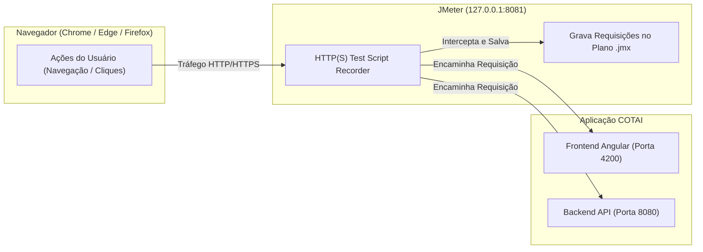

# COTAI — Guia Completo de Testes de Carga e Desempenho (JMeter)

Este documento apresenta o guia prático, passo a passo e de fácil compreensão para execução de **testes de carga e desempenho** no ecossistema **COTAI**, cobrindo tanto endpoints da **API (Spring Boot)** quanto rotas da **Web (Angular)** através do **Apache JMeter**, incluindo o uso do **Proxy de Gravação do Navegador**.

---

## 1. Desmistificando o Proxy: Gravação de Navegador vs. VPN/Squid

> [!IMPORTANT]
> **Esclarecimento fundamental sobre o uso de Proxy:**
> - **O que FOI solicitado para a Web:** O **HTTP(S) Test Script Recorder** do JMeter (Proxy de Gravação). O JMeter sobe um servidor proxy local na sua máquina (por padrão na porta `8081`). Você configura o seu navegador (Chrome, Edge ou Firefox) para apontar para `127.0.0.1:8081`. Conforme você navega nas telas do COTAI, o JMeter intercepta e grava automaticamente as páginas e requisições HTTP dentro do plano de testes.
> - **O que NÃO é:** Não se trata de uma VPN de rede, nem do container Squid (`cotai-proxy`) que o backend usa para fazer requisições externas para a internet. O proxy para testes Web é exclusivamente o gravador do navegador.



---

## 2. Estrutura de Arquivos e Ferramentas

Dentro da pasta `testes-desempenho/`:

| Arquivo / Pasta | Finalidade |
|---|---|
| `COTAI-Teste-Angular-Completo.jmx` | **Plano Unificado Principal**: Contém os grupos de API, Web Angular, gravação por Proxy e métricas. |
| `abrir-jmeter.bat` | Script de duplo clique para iniciar o JMeter já carregando o plano de testes. |
| `executar-carga-cli.ps1` | Script PowerShell automatizado para rodar testes sem interface (CLI) e gerar o relatório HTML. |
| `COTAI-Teste-Carga.jmx` | Plano legado focado apenas no backend (login e métricas). |
| `resultados/` | Pasta onde são gerados os arquivos de execução de métricas (`.jtl` e logs). |
| `relatorios/` | Pasta onde são criados os Dashboards HTML interativos com gráficos e estatísticas. |

---

## 3. Pré-requisitos

1. **Serviços do COTAI em execução:**
   - **PostgreSQL**: Rodando via Docker (`docker compose up -d` na pasta `backend/`).
   - **Backend Spring Boot**: Rodando e acessível em `http://localhost:8080`.
   - **Frontend Angular**: Rodando e acessível em `http://localhost:4200` (`npm start` na pasta `frontend/`).
2. **Apache JMeter 5.6.3+**:
   - Instalado e disponível no sistema (ex: `C:\{caminho}\JMeter\bin\jmeter.bat` ou via comando `jmeter`).
3. **Java (JDK 17 ou 21)**.

---

## 4. Passo a Passo: Como Usar o Gravador Proxy no Navegador

O gravador proxy permite capturar sua navegação real no sistema COTAI e convertê-la em requisições de teste no JMeter.

### Passo 1: Abrir o JMeter
Abra o JMeter executando o script `abrir-jmeter.bat` ou pelo PowerShell:
```powershell
jmeter -t .\COTAI-Teste-Angular-Completo.jmx
```

### Passo 2: Iniciar o Gravador no JMeter
1. No menu em árvore à esquerda, role até o final e clique no elemento **`HTTP(S) Test Script Recorder`**.
2. Confirme que a porta está definida como **`8081`** (ou a porta desejada).
3. O campo *Target Controller* já está configurado para direcionar para `WEB - Angular 4200 > Gravacao do Navegador (Recording Controller)`.
4. Clique no botão **`Start`** na parte inferior da tela.
5. Uma janela popup informará sobre o certificado temporário `ApacheJMeterTemporaryRootCA.crt` gerado na pasta `bin/` do JMeter. Clique em **`OK`**. O gravador estará ativo e aguardando tráfego.

### Passo 3: Configurar o Proxy no Windows / Navegador

#### Opção A — Configuração no Windows (Chrome / Edge):
1. Pressione `Win + R`, digite `inetcpl.cpl` e pressione Enter (ou vá em *Configurações do Windows > Rede e Internet > Proxy*).
2. Vá até a aba **Conexões** e clique em **Configurações da LAN**.
3. Marque a opção **"Usar um servidor proxy para a rede local..."**.
4. No campo **Endereço**, digite: `127.0.0.1` (ou `localhost`).
5. No campo **Porta**, digite: `8081`.
6. Desmarque "Não usar servidor proxy para endereços locais" (para permitir que ele intercepte o `localhost`).
7. Clique em **OK** para aplicar.

#### Opção B — Configuração direta no Mozilla Firefox:
1. Vá em *Configurações > Configurações de Rede > Configurar conexão...*
2. Selecione **Configuração manual de proxy**.
3. Proxy HTTP: `127.0.0.1`, Porta: `8081`.
4. Marque a opção: *"Usar este servidor proxy também para HTTPS"*.
5. Limpe o campo *"Sem proxy para"* para que o tráfego de `localhost` seja gravado.

### Passo 4: Navegar e Capturar os Fluxos Web
Com o gravador ativo e o proxy configurado:
1. Abra o navegador e acesse as rotas do COTAI:
   - `http://localhost:4200/` (Home page)
   - `http://localhost:4200/login` (Página de login)
   - `http://localhost:4200/register` (Página de cadastro)
   - `http://localhost:4200/l/seu-slug` (Lista pública de presentes)
2. No JMeter, observe que cada clique e transição de rota aparece automaticamente abaixo de **`WEB - Angular 4200 > Gravacao do Navegador (Recording Controller)`**!
3. O plano já conta com filtros que ignoram automaticamente imagens (`.png`, `.jpg`), fontes (`.woff2`, `.ttf`) e ícones (`.ico`), garantindo apenas as chamadas relevantes.

### Passo 5: Parar e Restaurar o Navegador
1. No JMeter, clique no botão **`Stop`** no painel do *HTTP(S) Test Script Recorder*.
2. **Importante:** Desmarque a configuração de proxy no Windows ou navegador para restaurar sua navegação normal na internet.

---

## 5. Passo a Passo: Execução dos Testes de Carga na Interface Gráfica (GUI)

A interface gráfica é ideal para visualizar o funcionamento, debugar respostas e verificar os relatórios visuais.

```text
Plano: COTAI - API, Web Angular e carga combinada
├── Variaveis do Plano (User Defined Variables: hosts, portas, usuarios)
├── 01 - Setup (Cria organizador e lista automaticamente antes do teste)
├── API - Backend 8080 (Grupo de teste para endpoints da API REST)
├── WEB - Angular 4200 (Grupo de teste para rotas e paginas Web)
├── RACE - ultima cota (Grupo concorrente para disputa de última cota)
├── View Results Tree (Inspecao detalhada de requests e responses)
├── Summary Report (Tabela de latencia, requisicoes e taxa de erros)
├── Aggregate Report (Percentis 90%, 95%, 99% e vazao em req/s)
└── HTTP(S) Test Script Recorder (Proxy de gravacao do navegador)
```

### Como Executar:
1. Abra o plano no JMeter (`abrir-jmeter.bat`).
2. Clique em **Variaveis do Plano (User Defined Variables)** para configurar a carga:
   - `webThreads`: Usuários simulados na Web (padrão: `20`).
   - `apiThreads`: Usuários simulados na API (padrão: `20`).
   - `rampSeconds`: Tempo em segundos para todos os usuários entrarem (padrão: `30`).
   - `loopCount`: Quantidade de repetições por usuário (padrão: `1`).
3. **Escolha o Cenário Desejado:**
   - **Apenas API:** Deixe `API - Backend 8080` habilitado e clique com o botão direito em `WEB - Angular 4200` > **Disable**.
   - **Apenas Web:** Deixe `WEB - Angular 4200` habilitado e clique com o botão direito em `API - Backend 8080` > **Disable**.
   - **Cenário Combinado:** Mantenha ambos os grupos habilitados.
4. Clique no botão **Play verde** (Start) na barra superior.
5. Selecione **Aggregate Report** ou **Summary Report** para acompanhar o throughput e os tempos de resposta em tempo real.

---

## 6. Passo a Passo: Execução via Linha de Comando (CLI / Headless) e Relatório HTML

> [!TIP]
> **Boas Práticas de Teste de Desempenho:** Testes de carga reais (10, 25, 50 ou mais usuários) devem ser executados em modo não gráfico (CLI / headless), pois a interface gráfica consome memória e CPU, o que pode distorcer as medições de latência.

### Modo Automático com o Script PowerShell (Recomendado):

Criamos o script `executar-carga-cli.ps1` que executa o teste, processa os dados, gera o Dashboard HTML completo e o abre no seu navegador automaticamente:

```powershell
# Executar carga leve com 10 usuários virtuais por grupo:
.\executar-carga-cli.ps1 -Usuarios 10 -RampUp 15

# Executar carga moderada com 25 usuários virtuais por grupo:
.\executar-carga-cli.ps1 -Usuarios 25 -RampUp 30

# Executar carga elevada com 50 usuários virtuais por grupo:
.\executar-carga-cli.ps1 -Usuarios 50 -RampUp 60
```

### Modo Nativo via JMeter:

Caso prefira executar o comando nativo do JMeter manualmente:

```powershell
# Execução do teste de carga e geração direta do relatório HTML
jmeter -n `
  -t ".\COTAI-Teste-Angular-Completo.jmx" `
  -JwebThreads=10 `
  -JapiThreads=10 `
  -JrampSeconds=15 `
  -l ".\resultados\resultado-10-usuarios.jtl" `
  -e -o ".\relatorios\relatorio-10-usuarios"
```

Para visualizar o relatório gerado:
```powershell
Start-Process ".\relatorios\relatorio-10-usuarios\index.html"
```

---

## 7. Mapeamento das Rotas e Endpoints Testados

### Rotas de API (`http://localhost:8080`):
- `POST /api/auth/register` — Cadastro de novo organizador com e-mail único por timestamp.
- `POST /api/auth/login` — Autenticação do organizador e extração do JWT Bearer token.
- `GET /api/events` — Catálogo público de tipos de eventos disponíveis (casamento, churrasco, etc.).
- `GET /api/events/BARBECUE/items` — Catálogo de itens sugeridos para o evento.
- `GET /api/public/gift-lists/{slug}` — Consulta pública da lista de presentes por convidados.
- `GET /api/gift-lists/{id}/metrics` — Consulta autenticada de métricas e arrecadação do organizador.
- `POST /api/public/items/{itemId}/reservations` — Reserva de cotas com cabeçalho de idempotência (`Idempotency-Key`).

### Rotas da Web Angular (`http://localhost:4200`):
- `GET /` — Página inicial institucional do COTAI.
- `GET /login` — Tela de login do organizador.
- `GET /l/{slug}` — Página pública de visualização de uma lista de presentes publicada.
- *(Rotas gravadas pelo Proxy)* — Quaisquer fluxos adicionais percorridos no navegador pelo gravador.

---

## 8. Como Interpretar as Métricas no Relatório

Ao abrir o arquivo `index.html` gerado na pasta de relatórios, você encontrará as seguintes métricas na tabela **Statistics**:

| Métrica | O que significa | O que avaliar |
|---|---|---|
| **# Samples** | Número total de requisições disparadas. | Confere se todos os usuários completaram as iterações planejadas. |
| **Average (ms)** | Tempo médio que a aplicação levou para responder. | Quanto menor, melhor. APIs saudáveis costumam responder abaixo de 200–500 ms. |
| **Median (ms)** | Valor mediano (50% das requisições foram mais rápidas que isso). | Mostra o comportamento típico, isolando picos isolados. |
| **90th / 95th / 99th pct** | Percentis de latência. | Mostra o pior cenário para a grande maioria dos usuários (ex: P95 = 95% dos usuários responderam abaixo desse tempo). |
| **Throughput (Vazão)** | Quantidade de requisições atendidas por segundo (`req/s`). | Mede a capacidade máxima de vazão do sistema sob concorrência. |
| **Error %** | Taxa de requisições com código de erro (4xx ou 5xx). | Deve ser **0,00%** sob condições normais de operação. |

---

## 9. Perguntas Frequentes & Solução de Problemas

1. **"Naveguei no browser mas nada apareceu no JMeter":**
   - Verifique se o botão **Start** do `HTTP(S) Test Script Recorder` foi clicado.
   - Verifique se o proxy do navegador está apontando exatamente para `127.0.0.1` e porta `8081`.
   - Certifique-se de que a opção de ignorar proxy para endereços locais está desmarcada.
2. **"Fiquei sem internet depois de fechar o JMeter":**
   - Ao fechar o JMeter, lembre-se de desativar o proxy manual nas configurações do Windows / navegador.
3. **"Erro de conexão recusada (Connection Refused / 500)":**
   - Certifique-se de que o backend (`http://localhost:8080`) e o frontend (`http://localhost:4200`) estão iniciados antes de rodar o teste.
4. **"A pasta de relatório já existe":**
   - O JMeter exige que a pasta de destino do relatório HTML (`-o`) esteja vazia ou não exista. O script `executar-carga-cli.ps1` gera pastas com timestamps automáticos para evitar esse conflito.
